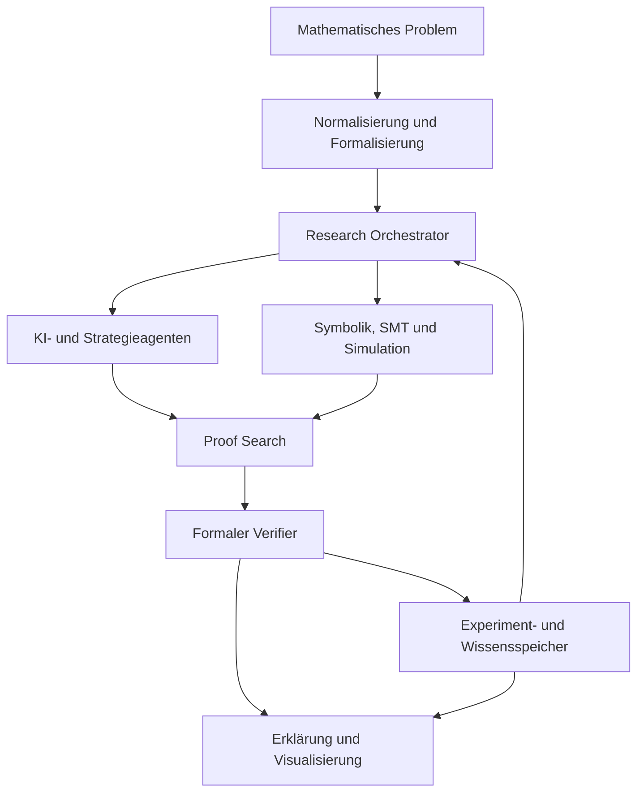
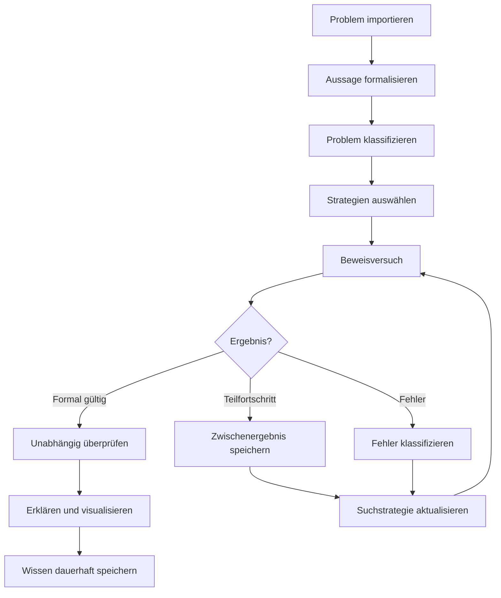

# E07 Agent Orchestrator und Multiagentensystem

- Status: `in-progress` · Meilenstein: M1, Ausbau M2 bis M6
- Quellen: ARCH §4.1, §6, §7.2, §15.5, §17.1, §17.3; UI §2.1 (System Configuration), §5
- Abhängige Epics: E01, E02, E04, E06, E24

## Ziel

Spezialisierte Agenten arbeiten über typisierte Nachrichten zusammen. Der Orchestrator plant, startet, überwacht und stoppt sie. Modelle sind über Adapter austauschbar, Rollen und Toolrechte sind konfiguriert und versioniert.

## Abgrenzung

Suchalgorithmen liegen in E08, Lernen in E12, die Agentenansicht der UI in E18. Die übrigen Rollen aus ARCH §6.1 und §6.2 liegen an anderer Stelle.

| Rolle | Ort |
| --- | --- |
| Problem Classifier | F-03.06 |
| Strategy Policy | F-06.06 |
| Budget Controller und Meta Controller (regelbasiert) | F-08.04 |
| Value Model | F-12.03 |
| Transfer Model | F-10.12 |
| Meta Controller (lernend) | F-12.12 |
| Explanation Agent und Explanation Model | E13 |

ARCH §6.1 hält fest, dass nicht jede Rolle ein eigenes neuronales Netz braucht. Jede Rolle startet mit der „ersten Implementierung“ aus der Tabelle in ARCH §6.1.

## Invarianten

Kein Agent setzt einen Verifikationsstatus, `VERIFIED` stammt nur aus dem verifizierenden Backend (ARCH §6.3). Agenten haben nur die Toolrechte ihrer Rolle. Im Modus `BLIND_REDISCOVERY` ruft kein Agent eine Referenzlösung ab. Agenten starten keine weiteren Agenten, sondern geben Aufgaben an den Orchestrator zurück (ARCH §6.4).

## Übersicht

| Feature | Titel | Status | Priorität | Meilenstein |
| --- | --- | --- | --- | --- |
| F-07.01 | Model Adapter | `todo` | P0 | M1 |
| F-07.02 | Typisierte Agentennachrichten | `done` | P0 | M1 |
| F-07.03 | Orchestrator-Kern | `todo` | P0 | M1 |
| F-07.04 | Tactic Generator | `todo` | P0 | M1 |
| F-07.05 | Koordination und Isolation | `todo` | P0 | M1 |
| F-07.06 | Proof Planner | `todo` | P1 | M2 |
| F-07.07 | Strategy Agents | `todo` | P1 | M2 |
| F-07.08 | Symbolic Agent und Experimental Agent | `todo` | P1 | M2 |
| F-07.09 | Verification Agent | `todo` | P0 | M1 |
| F-07.10 | Critic Agent und unabhängige Review | `todo` | P1 | M2 |
| F-07.11 | Knowledge Agent und Premise Retriever | `todo` | P1 | M3 |
| F-07.12 | Research Agent | `todo` | P2 | M6 |
| F-07.13 | Conjecture Generator und Counterexample Generator | `todo` | P1 | M2 |
| F-07.14 | Geometry Agent | `todo` | P2 | M5 |
| F-07.15 | Versionierte Agenten- und Modellprofile | `todo` | P1 | M2 |
| F-07.16 | Bedienung aus Claude Code über MCP und CLI | `todo` | P1 | M1 |

## Features

### F-07.01 Model Adapter

- Status: `todo` · Priorität: P0 · Meilenstein: M1
- Abhängigkeiten: F-01.04, F-00.01 (OD-03)
- Quelle: ARCH §17.1, §17.3, §22
- Bearbeiter: offen · Nachweise: offen

Einheitliche Schnittstelle für externe API-Modelle und lokale Modelle mit Modellversion, Inference-Konfiguration, Tokenzählung, Kosten, Timeout und Retry.

- [ ] Ein Fake-Modell und ein reales Modell laufen über dieselbe Schnittstelle.
- [ ] Jeder Aufruf speichert Modellversion, Tokens, Kosten und Latenz.

### F-07.02 Typisierte Agentennachrichten

- Status: `done` · Priorität: P0 · Meilenstein: M1
- Abhängigkeiten: F-01.02, F-02.02
- Quelle: ARCH §6.3
- Bearbeiter: Claude (Agent) · Nachweise: `src/mathlab/core/agent_messages.py` (Schema `AgentResultMessage`, strict, keine Zusatzfelder), `src/mathlab/messaging.py` (`report`, `adopt`, `VerificationResults`), neuer Eventtyp `agent.result.reported` als Katalogergänzung; `tests/test_messaging.py`, `tests/core/test_event_types.py`. `ruff format`, `ruff check` und `mypy` (strict) ohne Befund; `pytest` mit Test-DB 647 bestanden, 2 übersprungen, ohne DB 626 bestanden, 23 übersprungen. Ein `VERIFIED`-Anteil braucht in `verification_result_ids` die ID eines Prüfergebnisses aus `proof.step.verified`, `lemma.verified` oder `proof.completed`, sonst wird er als `UNRESOLVED` gespeichert und in `downgraded_parts` vermerkt. Annahme bis E04: Geprüft wird nur, ob das Prüfergebnis existiert, nicht ob es zum Anteil passt.

Ergebnisnachrichten folgen dem Schema aus ARCH §6.3 mit `task_id`, `agent`, `status`, `method`, `verification` (zum Beispiel `base_case` und `induction_step`), `evidence_ids`, `generated_lemmas`, `remaining_goals` und `recommended_next_action`. Sie erlauben resumierbare Workflows und gezielten Kontextabruf.

- [x] Eine Nachricht ohne gültiges Schema wird abgelehnt.
- [x] Ein Feld `verification` mit Wert `VERIFIED` wird nur übernommen, wenn eine passende Verifikation aus E04 vorliegt.
- [x] Jede Nachricht erscheint als Ereignis mit Trace-ID.

Referenzbeispiel aus ARCH §6.3, unverändert zitiert. Bei Abweichung gilt die Quelle.

```json
{
  "task_id": "TASK-1042",
  "agent": "induction_prover",
  "status": "PARTIAL_SUCCESS",
  "method": "mathematical_induction",
  "verification": {
    "base_case": "VERIFIED",
    "induction_step": "UNRESOLVED"
  },
  "evidence_ids": ["EVIDENCE-881"],
  "generated_lemmas": ["LEMMA-202"],
  "remaining_goals": 1,
  "recommended_next_action": "retrieve_algebraic_lemmas"
}
```

### F-07.03 Orchestrator-Kern

- Status: `todo` · Priorität: P0 · Meilenstein: M1
- Abhängigkeiten: F-07.02, F-01.06, F-00.01 (OD-04)
- Quelle: ARCH §4.1, §6.4, §7.2
- Bearbeiter: offen · Nachweise: offen

Startet, überwacht, pausiert und beendet Agenten pro Run und führt Workflow B aus ARCH §7.2 aus. Hält Budget und Abbruchkriterien ein und schreibt jeden Zustandswechsel als Ereignis (`agent.started` und folgende). Nimmt von Agenten zurückgegebene Aufgaben entgegen.

- [ ] Pause und Stop wirken innerhalb einer definierten Frist auf alle Agenten.
- [ ] Ein abgestürzter Agent wird als `FAILED` markiert, der Run läuft weiter oder endet kontrolliert.
- [ ] Die sechs Schritte aus ARCH §7.2 sind im Ereignisverlauf eines Runs nachvollziehbar.

Referenzbeispiel aus ARCH §4, unverändert zitiert. Bei Abweichung gilt die Quelle. Das Diagramm zeigt die Gesamtarchitektur, in der der Orchestrator arbeitet.



Referenzbeispiel aus ARCH §7, unverändert zitiert. Bei Abweichung gilt die Quelle. Das Diagramm zeigt den End-to-End-Workflow, den der Orchestrator steuert.



### F-07.04 Tactic Generator

- Status: `todo` · Priorität: P0 · Meilenstein: M1
- Abhängigkeiten: F-07.01, F-07.03, F-04.02
- Quelle: ARCH §6.1 (Tactic Generator), §7.2, §19 (Phase 1), §22 (Schritt 3)
- Bearbeiter: offen · Nachweise: offen

Proof-LLM, das Lean-Taktiken und vollständige Beweise für den aktuellen Proof State vorschlägt und an die Verification Engine gibt.

- [ ] Löst mindestens eine M1-Golden-Aufgabe mit Lean-Nachweis.
- [ ] Jeder Vorschlag wird als `proof.step.proposed` gespeichert.

### F-07.05 Koordination und Isolation

- Status: `todo` · Priorität: P0 · Meilenstein: M1
- Abhängigkeiten: F-07.03, F-24.02
- Quelle: ARCH §6.4
- Bearbeiter: offen · Nachweise: offen

Die sechs Regeln aus ARCH §6.4 werden technisch durchgesetzt.

1. Agenten erhalten nur ihre Aufgabe, benötigte Beweiszustände und relevante Daten.
2. Schreibzugriffe auf Beweis- und Wissensdaten laufen über geprüfte APIs.
3. Kritische Beweise prüfen ein unabhängiger Reviewer-Agent (F-07.10) und der formale Prüfer.
4. Toolaufrufe sind budgetiert und laufen ohne beliebige Shell- oder Netzrechte.
5. In Blind-Rediscovery-Läufen ist keine Referenzlösung abrufbar.
6. Agenten geben Aufgaben an den Orchestrator zurück, statt selbst Agenten zu starten.

- [ ] Ein Toolaufruf außerhalb der Rolle wird abgelehnt und protokolliert.
- [ ] Ein Abruf der Referenzlösung im Modus `BLIND_REDISCOVERY` schlägt fehl (Test).
- [ ] Ein Agent kann keinen weiteren Agenten starten (Test).

### F-07.06 Proof Planner

- Status: `todo` · Priorität: P1 · Meilenstein: M2
- Abhängigkeiten: F-07.04, F-08.02
- Quelle: ARCH §6.1 (Proof Planner)
- Bearbeiter: offen · Nachweise: offen

Reasoning-LLM, das das Theorem in Teilziele zerlegt und den Plan in den AND-OR-Graphen überträgt.

- [ ] Ein Plan erzeugt `proof.goal.created` für jedes Teilziel.

### F-07.07 Strategy Agents

- Status: `todo` · Priorität: P1 · Meilenstein: M2
- Abhängigkeiten: F-07.04, F-06.02
- Quelle: ARCH §6.2, §7.2 (Schritt 3), §15.5
- Bearbeiter: offen · Nachweise: offen

Agenten, die unabhängig je eine Methode verfolgen, etwa Induktion, Widerspruch, Algebra oder Konstruktion. Der Induction Agent aus ARCH §15.5 ist das erste Beispiel.

- [ ] Mehrere Strategy Agents laufen parallel auf getrennten Zweigen.
- [ ] Der Induction Agent beweist Induktionsanfang und Induktionsschritt des Referenzbeispiels aus ARCH §15.3.

### F-07.08 Symbolic Agent und Experimental Agent

- Status: `todo` · Priorität: P1 · Meilenstein: M2
- Abhängigkeiten: F-07.03, F-05.02, F-05.04
- Quelle: ARCH §6.2
- Bearbeiter: offen · Nachweise: offen

Der Symbolic Agent steuert CAS, exakte Umformungen und symbolische Solver über E05. Der Experimental Agent führt Simulationen, Parametersweeps und Gegenbeispieltests aus.

- [ ] Ergebnisse tragen die korrekte Erkenntnisstufe.

### F-07.09 Verification Agent

- Status: `todo` · Priorität: P0 · Meilenstein: M1
- Abhängigkeiten: F-07.03, F-04.04
- Quelle: ARCH §6.2, §7.3
- Bearbeiter: offen · Nachweise: offen

Formuliert Beweispflichten, reicht sie an die Verification Engine weiter und leitet Fehler an den Reparatur-Workflow (F-08.07) zurück. Er setzt selbst keinen Status.

- [ ] Verifikationsergebnisse stammen nachweislich aus E04.

### F-07.10 Critic Agent und unabhängige Review

- Status: `todo` · Priorität: P1 · Meilenstein: M2
- Abhängigkeiten: F-07.04
- Quelle: ARCH §6.1 (Proof Critic), §6.2 (Critic Agent), §6.4 (unabhängiger Reviewer)
- Bearbeiter: offen · Nachweise: offen

Sucht gezielt Annahmefehler, Lücken, Kreisbeweise und problematische Schritte, mit eigenem Kontext und ohne Zugriff auf die Begründung des Erzeugers. Erste Implementierung aus Regeln und LLM.

- [ ] Ein Testbeweis mit Kreisschluss wird markiert.
- [ ] Ein Testbeweis mit fehlender Voraussetzung wird markiert.

### F-07.11 Knowledge Agent und Premise Retriever

- Status: `todo` · Priorität: P1 · Meilenstein: M3
- Abhängigkeiten: F-07.03, F-10.06
- Quelle: ARCH §6.1 (Premise Retriever), §6.2 (Knowledge Agent), §7.2 (Schritt 2)
- Bearbeiter: offen · Nachweise: offen

Findet relevante Aussagen, Methoden, negative Versuche und Abhängigkeiten im Wissensgraphen. Der Premise Retriever startet mit Symbolsuche und Embeddings, ein trainierter Reranker folgt in E12.

- [ ] Abrufergebnisse enthalten Vertrauensebene und Herkunft.

### F-07.12 Research Agent

- Status: `todo` · Priorität: P2 · Meilenstein: M6
- Abhängigkeiten: F-07.11, F-25.07
- Quelle: ARCH §6.2, §19 (Phase 6)
- Bearbeiter: offen · Nachweise: offen

Definiert Hypothesen, Teilfragen, Risiken und einen Forschungsplan innerhalb eines Budgets.

- [ ] Jeder Forschungsplan ist mit Hypothesen, Teilfragen, Risiken und Budget gespeichert.

### F-07.13 Conjecture Generator und Counterexample Generator

- Status: `todo` · Priorität: P1 · Meilenstein: M2
- Abhängigkeiten: F-07.08, F-05.07
- Quelle: ARCH §6.1, §7.5
- Bearbeiter: offen · Nachweise: offen

Der Conjecture Generator formuliert neue Aussagen aus LLM und Regeln. Der Counterexample Generator sucht mit SMT und Suche gezielt Gegenbeispiele für Behauptungen und Zwischenlemmata.

- [ ] Vermutungen werden als `hypothesis.created` mit Stufe `CONJECTURED` gespeichert.

### F-07.14 Geometry Agent

- Status: `todo` · Priorität: P2 · Meilenstein: M5
- Abhängigkeiten: F-07.07
- Quelle: ARCH §15.4, §15.5 (Schritt 4)
- Bearbeiter: offen · Nachweise: offen

Spezialisierter Agent für den geometrischen Beweisweg, also die Darstellung von n² als Quadrat aus L-förmigen Schichten der Größe 2k−1.

- [ ] Der geometrische Beweis aus ARCH §15.4 wird als Plan und Visualisierung erzeugt.
- [ ] Die zugehörige formale Aussage wird an E04 übergeben, die Visualisierung allein gilt nicht als Beweis.

### F-07.15 Versionierte Agenten- und Modellprofile

- Status: `todo` · Priorität: P1 · Meilenstein: M2
- Abhängigkeiten: F-07.01
- Quelle: UI §2.1 (System Configuration), §5.2; ARCH §9.2
- Bearbeiter: offen · Nachweise: offen

Backend für Provider, Modelle, Prompts, Methoden, Budgets und Rechte als versionierte Profile. Jeder Run referenziert die verwendete Profilversion.

- [ ] Eine Profiländerung erzeugt eine neue Version, alte Runs zeigen weiter ihre ursprüngliche Version.

### F-07.16 Bedienung aus Claude Code über MCP und CLI

- Status: `todo` · Priorität: P1 · Meilenstein: M1
- Abhängigkeiten: F-14.01, F-01.04
- Quelle: ADR-0003
- Bearbeiter: offen · Nachweise: offen

MathLab stellt Runs, Problemimport, Taktikvorschlag und Ergebnisabfrage als MCP-Server und CLI bereit, sodass Claude Code Desktop das System lokal bedienen kann. Claude Code ist ein Agent ohne Sonderrechte.

- [ ] Claude Code startet über MCP einen Run und liest dessen Events.
- [ ] Ein Vorschlag aus Claude Code erzeugt ein Event mit Provenienz `claude-code` und geht an das Verifikations-Backend.
- [ ] Ein Test belegt, dass über MCP weder `VERIFIED` gesetzt noch die Zielaussage geändert werden kann.
