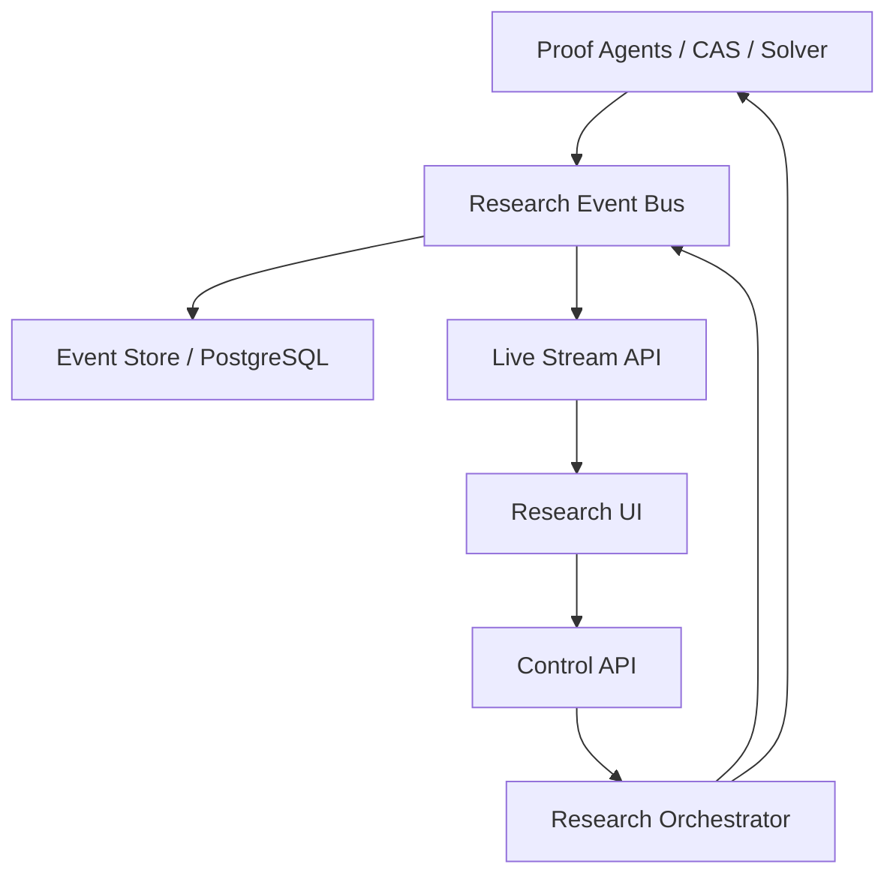

# E14 Backend API, Live Stream und Control API

- Status: `in-progress` · Meilenstein: M1, Ausbau M2, M3 und M6
- Quellen: ARCH §3.2, §18.2, §18.3, §19 (Phase 1); UI §5.3, §10.2, §15.1, §15.2, §16.3, §16.4, §17.2, §18.2, §19, §21 (Epics UI-01 und UI-07)
- Abhängige Epics: E01, E02, E07

## Ziel

Python und FastAPI stellen einen versionierten Lesezugriff, einen SSE-Eventstrom und eine getrennte Control API für Kommandos bereit. Die Oberfläche und die CLI greifen ausschließlich über diese Schnittstellen auf das System zu.

## Abgrenzung

Eventschema, Event Store, Snapshots und Idempotenz der Speicherung liegen in E02. Die Bedienelemente für Kommandos liegen in E20. Rechte und Rollen liegen in F-24.03.

## Invarianten

Der Server ist für mathematische und operative Fakten maßgeblich (UI §15.3). Die UI mutiert die Datenbank nie direkt (UI §18.3). Große Beweisterme und Logs gehen nicht durch den Live-Stream, sondern als Artefakt-ID (UI §16.4). Kein Kommando kann einen Knoten auf `VERIFIED` setzen.

## Übersicht

| Feature | Titel | Status | Priorität | Meilenstein |
| --- | --- | --- | --- | --- |
| F-14.01 | FastAPI-Grundgerüst und versioniertes API-Schema | `done` | P0 | M1 |
| F-14.02 | Lese-Endpunkte | `review` | P0 | M1 |
| F-14.03 | SSE-Live-Stream und Event-Nachladung | `done` | P0 | M1 |
| F-14.04 | Command API mit Serverbestätigung | `done` | P0 | M1 |
| F-14.05 | Erkennung konkurrierender Kommandos | `done` | P0 | M1 |
| F-14.06 | Artefaktverweise statt großer Payloads | `done` | P0 | M1 |
| F-14.07 | Verhalten bei Verbindungs- und Komponentenausfällen | `done` | P0 | M1 |
| F-14.08 | Endpunkt für Wissenssuche | `todo` | P1 | M3 |
| F-14.09 | CLI-App | `blocked` | P0 | M1 |
| F-14.10 | WebSockets bei nachgewiesenem Bedarf | `ready` | P2 | M6 |
| F-14.11 | Interner Research Event Bus | `review` | P0 | M1 |
| F-14.12 | Endpunkte zum Starten von Runs und der Golden Suite | `review` | P0 | M1 |
| F-14.13 | Runs nach einem Backend-Neustart | `todo` | P0 | M1 |

## Features

### F-14.01 FastAPI-Grundgerüst und versioniertes API-Schema

- Status: `done` · Priorität: P0 · Meilenstein: M1
- Abhängigkeiten: F-00.02, F-01.02
- Quelle: UI §16.4 (letzter Absatz), §19 (Backend); ARCH §18.2 (Versionierung, Fehlertypen, Trace-IDs)
- Bearbeiter: Claude · Nachweise: `src/mathlab/api/` mit `create_app()`, Präfix `/api/v1`, `GET /api/v1/health`, Header `X-Trace-Id` (gültige Client-UUID wird übernommen, sonst neu erzeugt) und `ErrorResponse` mit `ErrorType` und `trace_id` für Validierungs-, HTTP-, Engine- und unerwartete Fehler. Interne Fehlertexte werden nicht ausgegeben. `docs/reference/openapi-v1.json` wird mit `python -m mathlab.api.openapi` erzeugt; `--check` meldet Abweichungen, `--against` meldet Brüche (entfernte Pfade oder Operationen, neue Pflichtparameter). CI-Schritt „OpenAPI schema“ in `.github/workflows/ci.yml`. `tests/test_api.py` mit 14 Tests. ruff, ruff format und mypy strict ohne Befund; pytest 908 passed, 55 skipped. Der Vergleich gegen den Stand auf `main` bleibt Teil von F-00.06.

FastAPI-Anwendung mit OpenAPI-Schema, Versionspräfix, einheitlichen Fehlertypen und Trace-ID in jeder Antwort.

- [x] Das OpenAPI-Schema ist versioniert und wird in CI auf Kompatibilität geprüft (F-00.06).
- [x] Jede Fehlerantwort enthält Fehlertyp und Trace-ID.

### F-14.02 Lese-Endpunkte

- Status: `review` · Priorität: P0 · Meilenstein: M1
- Abhängigkeiten: F-14.01, F-02.05, F-02.06, F-02.07
- Quelle: UI §16.4
- Bearbeiter: Claude · Nachweise: Endpunkte in `src/mathlab/api/read.py`, Tests in `tests/test_api_read.py`, `PostgresEventStore.run_ids` mit Test in `tests/storage/test_events.py`, OpenAPI-Dokument `docs/reference/openapi-v1.json` neu erzeugt. Am 2026-11-27 liefen `ruff format --check`, `ruff check`, `mypy` (strict), `python -m mathlab.api.openapi --check` und `--against` gegen das vorherige v1-Dokument (keine brechende Änderung) sowie `pytest` mit 931 passed und 57 skipped, alle ohne Befund. Beleg Snapshot: Für jede Sequenz 1 bis 8 und für eine Sequenz über dem Ende gleicht `GET /runs/{run_id}/snapshot?at=n` dem `rebuild` der ersten n Ereignisse und nennt `sequence`, `snapshot_version` und `snapshot_sequence`. Festlegungen im Schema: Proof-Nodes liegen unter `/runs/{run_id}/proof-nodes/{node_id}`, weil der Store keinen Index von Knoten auf Runs hat. Artefakte werden als `application/octet-stream` ausgeliefert, solange der Medientyp nicht gespeichert wird. Der Agent-Graph enthält vorerst nur Agentenzustände, Kanten folgen mit E18. Ohne konfiguriertes Backend antworten die Endpunkte mit `UNAVAILABLE`. Offen vor `done`: Der Postgres-Test `test_run_ids_lists_every_run_with_events` wurde übersprungen, weil `MATHLAB_TEST_DATABASE_URL` nicht gesetzt war.

`GET /runs`, `GET /runs/{id}`, `GET /runs/{id}/snapshot`, `GET /runs/{id}/proof-graph`, `GET /runs/{id}/agent-graph`, `GET /proof-nodes/{id}` und `GET /artifacts/{id}`. Die Pfade in UI §16.4 sind illustrativ und werden im API-Schema festgelegt.

- [x] Jeder Endpunkt hat einen Contract-Test.
- [x] Ein Snapshot ist konsistent zu einer genannten Eventsequenz.

### F-14.03 SSE-Live-Stream und Event-Nachladung

- Status: `done` · Priorität: P0 · Meilenstein: M1
- Abhängigkeiten: F-14.01, F-02.03
- Quelle: UI §15.2, §16.4 (`/stream`, `/events?after=`), §17.2, §21 (Epic UI-01)
- Bearbeiter: Claude · Nachweise: Endpunkte in `src/mathlab/api/stream.py`, Tests in `tests/test_api_stream.py`. Der Bus beendet nach `close` auch spätere Abonnements sofort, der Test dafür steht in `tests/test_bus.py`. Das OpenAPI-Dokument `docs/reference/openapi-v1.json` ist neu erzeugt. Am 2026-11-27 liefen `ruff format --check`, `ruff check`, `mypy` (strict), `python -m mathlab.api.openapi --check` und `--against` gegen das vorherige v1-Dokument (keine brechende Änderung) sowie `pytest` mit 938 passed und 57 skipped, alle ohne Befund. Die Stream-Tests liefen dreimal hintereinander grün. Belege: Ein Client trennt nach Event 2, während der Trennung entstehen 4 und 5. Bei erneuter Verbindung mit `Last-Event-ID: 2` erhält er über HTTP 3, 4 und 5 in Reihenfolge. Ein `agent.started` erscheint im Stream, bevor der Run endet. Ein Event, das während des Nachladens aus dem Store veröffentlicht wird, kommt genau einmal an. Festlegungen: SSE-`id` ist die Sequenz, `event` der Eventtyp, `data` der Envelope als JSON. Der Startpunkt ist `Last-Event-ID`, sonst `?after=`, sonst 0. Ein leerlaufender Stream sendet alle 15 s einen Kommentar als Keep-alive. Fällt ein Abonnent hinter den Bus zurück, endet der Stream und der Client verbindet mit `Last-Event-ID` neu. `GET /runs/{run_id}/events` liefert höchstens 1000 Events pro Abruf.

SSE-Endpunkt pro Run mit der Sequenznummer als Event-ID und ein Endpunkt zum Nachladen ab einer Sequenz.

- [x] Ein Client, der mit `Last-Event-ID` neu verbindet, erhält alle verpassten Events in Reihenfolge.
- [x] Ein Agentenevent erscheint während der Ausführung im Stream (UI §20, Kriterium 1).

### F-14.04 Command API mit Serverbestätigung

- Status: `done` · Priorität: P0 · Meilenstein: M1
- Abhängigkeiten: F-14.01, F-02.04, F-07.03
- Quelle: UI §10.2, §16.3, §5.3, §21 (Epic UI-07)
- Bearbeiter: Claude · Nachweise: Endpunkt und `CommandService` in `src/mathlab/api/control.py`, Audit-Eventtypen `command.accepted` und `command.rejected` in `src/mathlab/core/event_types.py`, Tests in `tests/test_api_control.py` und `tests/core/test_event_types.py`. `docs/reference/event-types.md` und `docs/reference/openapi-v1.json` sind neu erzeugt. Am 2026-11-27 liefen `ruff format`, `ruff check`, `mypy` (strict), `python -m mathlab.api.openapi --check` und `--against` gegen das vorherige v1-Dokument (keine brechende Änderung) sowie `pytest` mit 959 passed und 57 skipped, alle ohne Befund. Belege: Dieselbe `command_id` zweimal, auch fünfmal gleichzeitig, führt das Kommando einmal aus; die Wiederholung liefert dieselbe Bestätigung mit `duplicate: true` oder denselben Fehler. Jede Annahme und jede Ablehnung (unbekannter Typ, falscher Status, fehlende Bestätigung bei `run.stop`, inaktiver Run, abweichende `run_id`, wiederverwendete `command_id` mit anderem Inhalt) hinterlässt genau ein Audit-Event. Kommandos wie `proof_node.set_verified` mit `status: VERIFIED` werden mit `VALIDATION_ERROR` abgelehnt und ändern nichts. Ein echter Orchestrator wird über die API pausiert, fortgesetzt und beendet. Festlegungen: M1 kennt nur `run.pause`, `run.resume` und `run.stop` (mit `parameters.confirm: true`). Die Audit-`event_id` ist UUIDv5 aus Run und `command_id`; `state_version` in der Bestätigung ist die Sequenz des Audit-Events. `expected_state_version` wird erfasst, geprüft wird es in F-14.05.

`POST /runs/{id}/commands` mit `command_id`, `type`, `run_id`, optional `branch_id`, `agent_id` und `proof_node_id`, dazu `requested_by`, `expected_state_version` und `parameters`. Antwort ist eine Bestätigung mit neuem Zustandsstand oder ein begründeter Fehler. Jedes Kommando erzeugt ein Audit-Event. Die Control API ist vom Lesezugriff getrennt.

- [x] Ein wiederholt gesendetes Kommando mit gleicher `command_id` wird genau einmal ausgeführt.
- [x] Jedes angenommene oder abgelehnte Kommando ist als Audit-Event im Log.
- [x] Ein Kommando, das `VERIFIED` setzen soll, existiert nicht und wird abgelehnt (Test).

Referenzbeispiel aus UI §16.3, unverändert zitiert. Bei Abweichung gilt die Quelle.

```json
{
  "command_id": "cmd-00119",
  "type": "branch.investigate",
  "run_id": "run-0042",
  "branch_id": "branch-induction-03",
  "requested_by": "user",
  "expected_state_version": 35,
  "parameters": {
    "strategy": "algebraic_lemmas",
    "max_runtime_seconds": 900,
    "model_profile": "local_prover"
  }
}
```

### F-14.05 Erkennung konkurrierender Kommandos

- Status: `done` · Priorität: P0 · Meilenstein: M1
- Abhängigkeiten: F-14.04
- Quelle: UI §10.2 (`expected_state_version`), §18.2 (Commands gleichzeitig)
- Bearbeiter: Claude · Nachweise: Prüfung in `CommandService` (`src/mathlab/api/control.py`), Tests in `tests/test_api_control.py`. Am 2026-11-27 liefen `ruff format --check`, `ruff check`, `mypy` (strict), `python -m mathlab.api.openapi --check` (Schema unverändert) sowie `pytest` mit 962 passed und 57 skipped, alle ohne Befund. Die Kommando-Tests liefen dreimal hintereinander grün. Belege: Zwei gleichzeitige Kommandos (`run.pause` und `run.stop`) auf Stand 0 ergeben genau eine Ausführung und einen `CONFLICT`, dessen Meldung den aktuellen Stand nennt; beide sind auditiert. Ein Kommando mit veraltetem Stand wird abgelehnt, nach dem Nachladen des Stands gelingt es. Der Stand wird nach einem Neustart aus dem Event Store wiederhergestellt. Festlegung, da UI §10.2 den Zustandsstand nicht definiert: Der Stand eines Runs ist die Sequenz seines letzten angenommenen Kommandos (`command.accepted`), 0 ohne Kommando. Er entspricht `state_version` der Bestätigung. Agenten-Events und abgelehnte Kommandos ändern ihn nicht, sonst würde ein Kommando auf einen aktiven Run fast immer mit den Agenten kollidieren. Eine erneut gesendete, bereits beantwortete `command_id` wiederholt die erste Antwort und wird nicht erneut geprüft.

Stimmt `expected_state_version` nicht mit dem aktuellen Stand überein, wird das Kommando mit Versionskonflikt abgelehnt und der Client lädt den neuesten Zustand.

- [x] Zwei gleichzeitige Kommandos auf denselben Stand ergeben genau eine Ausführung und einen Konflikt.

### F-14.06 Artefaktverweise statt großer Payloads

- Status: `done` · Priorität: P0 · Meilenstein: M1
- Abhängigkeiten: F-14.03, F-02.07
- Quelle: UI §16.4 (letzter Absatz), §17.2, §18.2 (große Events)
- Bearbeiter: Claude · Nachweise: `offload_large_values` in `src/mathlab/storage/artifacts.py`, Auslagerung im `ResearchEventBus` (`artifacts`, `max_inline_bytes`) in `src/mathlab/bus.py`. Tests in `tests/test_api_stream.py` und `tests/storage/test_artifacts.py`. Am 2026-11-27 liefen `ruff format --check`, `ruff check`, `mypy` (strict), `python -m mathlab.api.openapi --check` (API unverändert) und `pytest` mit 972 passed und 57 skipped, alle ohne Befund. Beleg: Ein `proof.step.rejected` mit etwa 70 KB Lean-Log erreicht den Stream als Nachricht unter 4 KB; `message` enthält nur die `ArtifactRef`, der Logtext fehlt. `GET /artifacts/{ref}` liefert den Log unverändert. Eine erneute Zustellung speichert dieselbe Referenz ohne Konflikt und ohne zweite Sequenz. Ein kleiner Payload bleibt inline, und es entsteht kein Artefakt. Festlegungen: Der Bus lagert aus, bevor er speichert, damit Store und Stream dieselbe kleine Fassung tragen. Ausgelagert werden die größten String-Werte der obersten Ebene, bis die Grenze (Standard 16 KiB) eingehalten ist. Das Feld behält seinen Typ und enthält `sha256:<hex>`, weil die strikten Payload-Schemas kein Zusatzfeld erlauben. Verschachtelte Inhalte werden nicht ausgelagert; ein solcher Payload scheitert weiter an `enforce_inline_limit`. Die Grenze ist über `max_inline_bytes` konfigurierbar.

Payloads oberhalb einer konfigurierten Größe werden im Artefaktspeicher abgelegt. Der Stream überträgt nur die Artefakt-ID.

- [x] Ein Event mit großem Lean-Log enthält im Stream nur die ID, das Artefakt ist über F-14.02 abrufbar.

### F-14.07 Verhalten bei Verbindungs- und Komponentenausfällen

- Status: `done` · Priorität: P0 · Meilenstein: M1
- Abhängigkeiten: F-14.03, F-02.08
- Quelle: UI §18.2
- Bearbeiter: Claude · Nachweise: `AgentActivity` und die Felder `reason` und `last_activity` von `AgentView` in `src/mathlab/projections.py`, `SNAPSHOT_FORMAT_VERSION = 2` in `src/mathlab/storage/snapshots.py`. Tests in `tests/test_api_failures.py`, Parameter `checker` der Testhilfe `system` in `tests/test_api_runs.py`. `docs/reference/openapi-v1.json` ist neu erzeugt. Am 2026-11-27 liefen `ruff format`, `ruff check`, `mypy` (strict), `python -m mathlab.api.openapi --check` und `--against` gegen das vorherige v1-Dokument (keine brechende Änderung) sowie `pytest` mit 976 passed und 57 skipped, alle ohne Befund. Die Ausfalltests liefen dreimal hintereinander grün. Belege mit je einem Integrationstest über die API: (1) SSE getrennt: Nach einem Odd-Sum-Run liefert `GET /runs/{id}/stream` mit `Last-Event-ID: 3` genau die gespeicherten Events ab Sequenz 4 bis `run.completed`. (2) Agent abgestürzt: Der Agent-Graph zeigt den Agenten `FAILED` mit Grund `RuntimeError: model process died` und als `last_activity` sein letztes Event vor dem Absturz. (3) Verifier nicht verfügbar: Der Checker wirft `EngineUnavailableError`; es entsteht kein `proof.step.verified`, `lemma.verified` oder `proof.completed`, der Snapshot enthält weder `VERIFIED` noch `REJECTED`, der vorgeschlagene Schritt bleibt `OPEN`, und der Agent steht mit Grund `EngineUnavailableError` auf `FAILED`. (4) Backend-Neustart: Neue Bus-, Command- und Leseinstanzen über denselben Event- und Snapshot-Speicher laden den Snapshot (Sequenz 3) und liefern denselben Zustand wie der Neuaufbau und dieselbe Rundetail-Antwort. Ein Kommando danach wird abgelehnt, sein Audit-Event erhält die nächste Sequenz und erscheint im Stream ab `Last-Event-ID`. Festlegungen: Die Agentenprojektion übernimmt `agent.status.changed` mit Grund; `last_activity` ist das letzte Event des Agenten ohne seine Statuswechsel. Die Snapshot-Formatversion steigt auf 2, ältere Snapshots werden ignoriert und neu aufgebaut. Beobachtet, nicht geändert: Stürzt der einzige Agent ab, endet der Run mit `COMPLETED`, solange `fail_run_on_agent_failure` nicht gesetzt ist. Ein Run, der beim Neustart noch lief, bleibt ohne Controller `RUNNING`; nachgetragen als F-14.13.

Das Backend liefert für die Fehlerfälle aus UI §18.2 die nötigen Zustände. Ein abgestürzter Agent erhält einen Fehlerstatus mit letzter bekannter Aktivität. Ist der Verifier nicht verfügbar, bleibt der Prüfstatus offen oder unterbrochen. Nach einem Backend-Neustart wird der Snapshot geladen und die Eventsequenz fortgesetzt. Die Fälle Versionskonflikt, große Events und Replay liegen in F-14.05, F-14.06 und F-19.07.

- [x] Für jeden der vier hier behandelten Fehlerfälle gibt es einen Integrationstest.
- [x] Ein Verifier-Ausfall führt nie zu einem gültigen Prüfstatus.

### F-14.08 Endpunkt für Wissenssuche

- Status: `todo` · Priorität: P1 · Meilenstein: M3
- Abhängigkeiten: F-14.01, F-10.06
- Quelle: UI §16.4 (`/knowledge/search`)
- Bearbeiter: offen · Nachweise: offen

Theorem- und Lemma-Suche über die Retrieval-Pipeline. Jeder Treffer enthält seine Vertrauensebene.

- [ ] Nicht verifizierte Treffer sind in der Antwort als solche markiert.

### F-14.09 CLI-App

- Status: `blocked` · Priorität: P0 · Meilenstein: M1
- Abhängigkeiten: F-14.04, F-14.03, F-14.12
- Quelle: ARCH §18.3 (`apps/cli`), §19 (Phase 1, CLI oder einfache Web-UI)
- Bearbeiter: offen · Nachweise: offen

Kommandozeile zum Starten, Beobachten, Pausieren und Beenden von Runs sowie zum Starten der Golden Suite. Nutzt dieselbe API wie die Oberfläche.

- [ ] Die Odd-Sum-Aufgabe lässt sich vollständig über die CLI lösen und das Ergebnis abrufen.

### F-14.10 WebSockets bei nachgewiesenem Bedarf

- Status: `ready` · Priorität: P2 · Meilenstein: M6
- Abhängigkeiten: F-14.03
- Quelle: UI §15.2
- Bearbeiter: offen · Nachweise: offen

WebSockets werden erst eingeführt, wenn eine konkrete Interaktion wie Kollaboration sie benötigt.

- [ ] Der Bedarf ist in einem ADR begründet, bevor implementiert wird.

### F-14.12 Endpunkte zum Starten von Runs und der Golden Suite

- Status: `review` · Priorität: P0 · Meilenstein: M1
- Abhängigkeiten: F-14.04, F-14.03, F-11.03
- Quelle: ARCH §18.3, §19 (Phase 1); UI §5.3, §16.4. Angelegt am 2026-11-27 bei der Arbeit an F-14.09, weil die API keinen Run starten konnte.
- Bearbeiter: Claude · Nachweise: `src/mathlab/api/runs.py` (`RunLauncher`, `POST /runs`, `POST /golden-suite/runs`), `ResearchEventBus.append` in `src/mathlab/bus.py`, Lückenfüllung in `src/mathlab/api/stream.py`, Audit über den Bus in `src/mathlab/api/control.py`, `prepare_run` in `src/mathlab/golden_suite.py`. Tests in `tests/test_api_runs.py`, `tests/test_bus.py` und `tests/test_api_stream.py`. `docs/reference/openapi-v1.json` ist neu erzeugt. Am 2026-11-27 liefen `ruff format`, `ruff check`, `mypy` (strict), `python -m mathlab.api.openapi --check` und `--against` gegen das vorherige v1-Dokument (keine brechende Änderung) sowie `pytest` mit 968 passed und 57 skipped, alle ohne Befund. Die betroffenen Testdateien liefen dreimal hintereinander grün. Belege: Ein über `POST /runs` gestarteter Run schreibt über den Bus; ein Abonnent sieht seine Events live, `run.pause` und `run.stop` über den `CommandService` halten ihn an, `run.paused`, die Audit-Events und `run.completed` erscheinen im Stream. Ein Odd-Sum-Run (`g08`) endet `COMPLETED` mit `proof.step.verified`, dessen Prüfarchiv über `GET /artifacts/{ref}` abrufbar ist. Der Golden-Suite-Lauf über die API liefert denselben Bericht wie `run_suite` bis auf die gemessenen Laufzeiten. Offen vor `done`: Alle Läufe nutzten den Fake-Checker der Golden-Suite-Tests, weil Docker und das Lean-Image hier nicht verfügbar sind. Der Odd-Sum-Lauf gegen das echte Lean-Image ist nachzuholen. Festlegungen: Ein Run gilt als Kontrollziel, solange er im Server läuft; danach antworten Kommandos mit „run is not active“. Der Orchestrator schreibt synchron über `ResearchEventBus.append`. Weil dadurch Events eines Runs in anderer Reihenfolge beim Abonnenten ankommen können, liest der Stream eine Lücke aus dem Store nach. Der Golden-Suite-Endpunkt antwortet erst nach Ende des Laufs. Der Proof-Graph bleibt in diesem Ablauf leer, weil Tactic Generator und Verification Agent keine `proof.node.*`-Events schreiben; nachgetragen als F-08.13.

`POST /runs` startet einen Run für eine Aufgabe der Golden-Liste im Prozess des Servers. Die Events laufen über den Research Event Bus, sodass Stream und Control API den Run sehen. Ein zweiter Endpunkt startet die Golden Suite und liefert ihr Ergebnis als `EvaluationRun`. Der Server bleibt maßgeblich, der Client übergibt nur Aufgabe und Budget.

- [x] Ein über `POST /runs` gestarteter Run erscheint im Stream und lässt sich über `POST /runs/{run_id}/commands` pausieren und beenden.
- [x] Ein Run der Odd-Sum-Aufgabe endet mit verifiziertem Beweis, abrufbar über die Lese-Endpunkte.
- [x] Ein Golden-Suite-Lauf über die API liefert denselben Bericht wie `run_suite`.

### F-14.13 Runs nach einem Backend-Neustart

- Status: `todo` · Priorität: P0 · Meilenstein: M1
- Abhängigkeiten: F-14.12, F-02.08
- Quelle: UI §18.2 (Backend-Neustart). Angelegt am 2026-11-27 bei der Arbeit an F-14.07: Ein Run, der beim Neustart im Server lief, hat danach keinen Controller mehr und bleibt im Lesezugriff `RUNNING`, Kommandos antworten mit „run is not active“.
- Bearbeiter: offen · Nachweise: offen

Beim Start erkennt der Server Runs, deren letztes Event kein `run.completed` ist. Er setzt sie mit `resume` aus Snapshot und Events fort oder beendet sie mit einem eigenen Ereignis und begründetem Status. Die Historie bleibt unverändert.

- [ ] Nach einem Neustart mitten in einem Run steht dieser nie dauerhaft auf `RUNNING` ohne Controller.
- [ ] Der Übergang ist als neues Event protokolliert, die Sequenz läuft lückenlos weiter.

### F-14.11 Interner Research Event Bus

- Status: `review` · Priorität: P0 · Meilenstein: M1
- Abhängigkeiten: F-02.03, F-00.01 (OD-04)
- Quelle: UI §15.1, §15.2 (interne Backend-Kommunikation)
- Bearbeiter: Claude · Nachweise: `src/mathlab/bus.py`, `tests/test_bus.py`. Am 2026-11-27 liefen `ruff format --check`, `ruff check` und `mypy` (strict) ohne Befund, `pytest` mit 914 passed und 56 skipped. Der Postgres-Test `test_redelivery_against_postgres_persists_once` wurde übersprungen, weil `MATHLAB_TEST_DATABASE_URL` nicht gesetzt war. Er ist vor `done` nachzuholen.

Agenten, CAS und Solver veröffentlichen Ergebnisse über einen Bus oder eine Queue. Der Bus schreibt in den Event Store und speist den Live-Stream, der Orchestrator abonniert ihn. Die Wahl der Technik folgt OD-04.

- [x] Ein Event wird genau einmal persistiert, auch wenn der Bus es mehrfach zustellt.

Referenzbeispiel aus UI §15.1, unverändert zitiert. Bei Abweichung gilt die Quelle.


