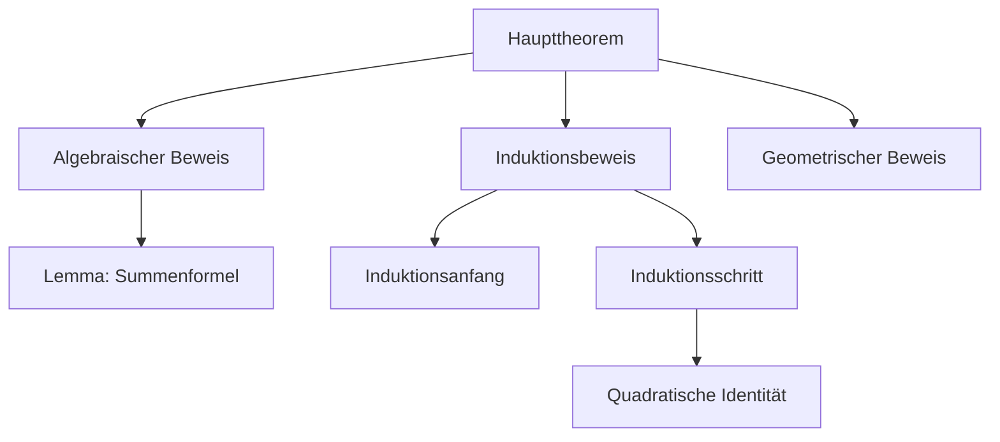

# E16 Proof Search Graph UI

- Status: `todo` · Meilenstein: M1, Ausbau M2
- Quellen: ARCH §14.1 (Proof Tree); UI §4, §8.3, §14.4, §18.1, §19, §19.2, §20 (Stufe 1), §21 (Epic UI-03)
- Abhängige Epics: E08, E14, E15

## Ziel

Der Proof Search Graph ist das fachliche Herzstück der Oberfläche. Er zeigt den AND-OR-Hypergraphen der Beweissuche live, interaktiv und auch bei großen Graphen flüssig.

## Abgrenzung

Das Domänenmodell liegt in F-08.02. Der operative Agentengraph liegt in E18. Kommandos aus dem Kontextmenü laufen über E20.

## Invarianten

Kein Mensch kann einen Knoten per Klick ohne formalen Prüfnachweis auf `VERIFIED` setzen (UI §4.4). Status wird immer mit Label und Icon gezeigt. Aktualisierungen werden aggregiert dargestellt, alle Originalevents bleiben persistiert (UI §18.1).

## Übersicht

| Feature | Titel | Status | Priorität | Meilenstein |
| --- | --- | --- | --- | --- |
| F-16.01 | Viewmodell für AND- und OR-Ziele | `todo` | P0 | M1 |
| F-16.02 | Custom Nodes mit Status | `todo` | P0 | M1 |
| F-16.03 | Zoom, Pan, Collapse und Layouts | `todo` | P0 | M1 |
| F-16.04 | Graphfilter | `todo` | P1 | M1 |
| F-16.05 | Graph-Deltas aus dem Eventstrom | `todo` | P0 | M1 |
| F-16.06 | Auswahl-Synchronisierung | `todo` | P0 | M1 |
| F-16.07 | Kontextmenü und Detailaufrufe | `todo` | P1 | M2 |
| F-16.08 | Vergleich alternativer Beweise | `todo` | P1 | M2 |
| F-16.09 | Performance bei großen Graphen | `todo` | P1 | M1 |

## Features

### F-16.01 Viewmodell für AND- und OR-Ziele

- Status: `todo` · Priorität: P0 · Meilenstein: M1
- Abhängigkeiten: F-08.02, F-14.02, F-15.01
- Quelle: UI §4.1, §21 (Epic UI-03)
- Bearbeiter: offen · Nachweise: offen

Abbildung der Knoten und der Kanten `OR`, `AND`, `DEPENDS_ON`, `REUSES` und `REFUTES` auf eine Graphbibliothek, laut UI §19 React Flow, abhängig von OD-01.

- [ ] Alle fünf Kantentypen sind visuell unterscheidbar und beschriftet.

Referenzbeispiel aus UI §4.1, unverändert zitiert. Bei Abweichung gilt die Quelle.

### F-16.02 Custom Nodes mit Status

- Status: `todo` · Priorität: P0 · Meilenstein: M1
- Abhängigkeiten: F-16.01, F-15.06
- Quelle: UI §4.2, §4.3, §21 (Epic UI-03)
- Bearbeiter: offen · Nachweise: offen

Knoten zeigen Kurztitel oder Zielaussage, Methode, Verifikations- und Arbeitsstatus, Zahl offener Teilziele, Priorität, optional geschätzte Lösbarkeit als Schätzung, Agent und Zeit der letzten Änderung. Im Zoom-Out nur Titel, Knotenart und Status. Status `VERIFIED`, `RUNNING`, `WAITING`, `FAILED`, `CONJECTURED`, `ABANDONED` und `REFUTED` mit Farbe und Icon.

- [ ] `VERIFIED` erscheint nur bei vorhandenem Verifikationsartefakt (UI §20, Kriterium 7).
- [ ] Die geschätzte Lösbarkeit ist als Schätzung gekennzeichnet.

### F-16.03 Zoom, Pan, Collapse und Layouts

- Status: `todo` · Priorität: P0 · Meilenstein: M1, weitere Layouts M2
- Abhängigkeiten: F-16.02
- Quelle: UI §4.4, §21 (Epic UI-03)
- Bearbeiter: offen · Nachweise: offen

Zoom, Pan, Ein- und Ausklappen von Teilzielen, Fokus auf Teilgraph per Doppelklick. Layout hierarchisch in M1, nach Methode, Zeit und Abhängigkeit in M2.

- [ ] Ein eingeklappter Teilgraph zeigt die Zahl verborgener Knoten und ihren aggregierten Status.

### F-16.04 Graphfilter

- Status: `todo` · Priorität: P1 · Meilenstein: M1
- Abhängigkeiten: F-16.02
- Quelle: UI §4.4 (Filter), §20 (Stufe 2, Graphfilter)
- Bearbeiter: offen · Nachweise: offen

Filter nach Methode, Agent, Status, Verifikationsgrad und Zeitfenster.

- [ ] Gefilterte Knoten sind ausgeblendet, ihre Kanten werden als zusammengefasst angezeigt.

### F-16.05 Graph-Deltas aus dem Eventstrom

- Status: `todo` · Priorität: P0 · Meilenstein: M1
- Abhängigkeiten: F-16.01, F-14.03
- Quelle: UI §8.1, §18.1, §20 (Kriterium 2), §21 (Epic UI-03)
- Bearbeiter: offen · Nachweise: offen

Events wie `proof.branch.created`, `proof.goal.created`, `proof.step.proposed`, `proof.step.verified`, `proof.step.rejected`, `lemma.verified`, `hypothesis.created` und `counterexample.found` werden als Deltas angewendet.

- [ ] `proof.step.verified` aktualisiert den verknüpften Knoten ohne Neuladen.
- [ ] Der Graph nach allen Deltas entspricht `GET /runs/{id}/proof-graph`.

### F-16.06 Auswahl-Synchronisierung

- Status: `todo` · Priorität: P0 · Meilenstein: M1
- Abhängigkeiten: F-16.02, F-15.09
- Quelle: UI §4.4 (Klick), §8.3 (letzter Absatz), §14.4, §21 (Epic UI-03)
- Bearbeiter: offen · Nachweise: offen

Ein Klick öffnet den Knoten im Inspector. Eine Auswahl in Timeline, Inspector oder Wissensgraph markiert denselben Knoten in allen geöffneten Ansichten.

- [ ] Eine Auswahl bleibt beim Wechsel zwischen Ansichten erhalten.

### F-16.07 Kontextmenü und Detailaufrufe

- Status: `todo` · Priorität: P1 · Meilenstein: M2
- Abhängigkeiten: F-16.06, F-20.03, F-20.04
- Quelle: UI §4.4 (Kontextmenü, Rechtsklick)
- Bearbeiter: offen · Nachweise: offen

Kontextmenü mit neuer Strategie, Priorität ändern, Agent zuweisen und neuer Exploration als Kommandos. Detailaufruf für Tactic-Log, Proof State, Lean-Code, Quellen und Axiome im Inspector.

- [ ] Kein Menüeintrag setzt einen Verifikationsstatus.

### F-16.08 Vergleich alternativer Beweise

- Status: `todo` · Priorität: P1 · Meilenstein: M2
- Abhängigkeiten: F-16.03, F-08.10
- Quelle: UI §4.4 (Vergleich), §20 (Stufe 2, Kriterium 2)
- Bearbeiter: offen · Nachweise: offen

Alternative Beweise desselben Ziels nebeneinander.

- [ ] Algebraischer und induktiver Odd-Sum-Beweis sind nebeneinander darstellbar.

### F-16.09 Performance bei großen Graphen

- Status: `todo` · Priorität: P1 · Meilenstein: M1
- Abhängigkeiten: F-16.05
- Quelle: UI §18.1, §19.2, §21 (Epic UI-03, Tests mit großen Graphen)
- Bearbeiter: offen · Nachweise: offen

Nur sichtbare Knoten rendern, Teilgraphen standardmäßig zusammenfassen, Level of Detail nach Zoom, inkrementelles Layout im Hintergrund, aggregierte UI-Updates bei hoher Eventrate, Proof States erst bei Auswahl laden, memoisierte Komponenten ohne unnötige Subscriptions.

- [ ] Ein Testgraph mit 5000 Knoten bleibt bei Zoom und Pan bedienbar. Die Größe 5000 ist eine Annahme des Backlogs und wird im Test dokumentiert.
