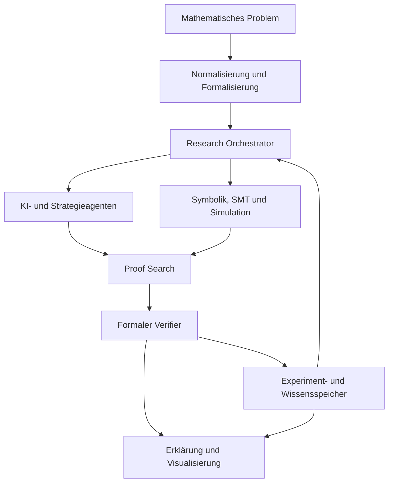
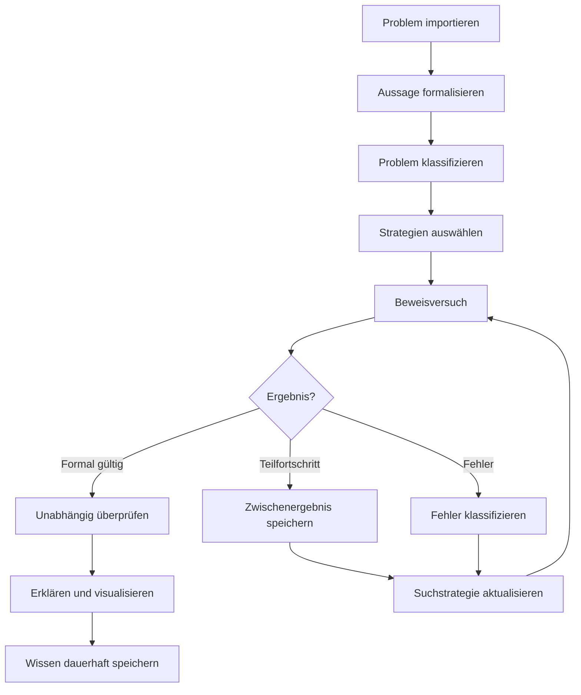

# Autonomes mathematisches Beweis- und Entdeckungssystem

**Ausführliches Forschungs-, Architektur- und Implementierungskonzept**  
**Stand der Recherche:** 21. November 2026  
**Arbeitstitel:** Artificial Mathematical Research System (AMRS)  
**Schwerpunkte:** Automated Theorem Proving, Formal Verification, KI-Agenten, Reinforcement Learning, mathematischer Wissensgraph, symbolische Mathematik, Simulation, Continual Learning, mathematische Erklärbarkeit

> **Zweck dieses Dokuments:** Vollständige, zusammenhängende Ausarbeitung der im Chat diskutierten Idee. Es handelt sich um ein technisches Zielkonzept mit Forschungshypothesen und vorgeschlagener Implementierung, nicht um eine bereits implementierte oder experimentell bestätigte Gesamtarchitektur. Leistungszahlen aus Papers sind an deren jeweilige Benchmarks und Rechenbudgets gebunden. Forschungsarbeiten im Preprint-Stadium werden als solche eingeordnet.

## Inhaltsverzeichnis

1. [Vision und Ziele](#1-vision-und-ziele)
2. [Wissenschaftliche Grundlagen und Forschungslage](#2-wissenschaftliche-grundlagen-und-forschungslage)
3. [Anforderungen und Betriebsmodi](#3-anforderungen-und-betriebsmodi)
4. [Gesamtarchitektur](#4-gesamtarchitektur)
5. [Mathematische Methoden als ausführbare Strategien](#5-mathematische-methoden-als-ausführbare-strategien)
6. [KI-Modelle und Multiagentensystem](#6-ki-modelle-und-multiagentensystem)
7. [End-to-End-Workflows](#7-end-to-end-workflows)
8. [Proof Search und Suchsteuerung](#8-proof-search-und-suchsteuerung)
9. [Trial-and-Error, Experimentdaten und Feedback](#9-trial-and-error-experimentdaten-und-feedback)
10. [Metriken, Reward und Lernverfahren](#10-metriken-reward-und-lernverfahren)
11. [Wissensgraph und mathematisches Langzeitgedächtnis](#11-wissensgraph-und-mathematisches-langzeitgedächtnis)
12. [Symbolische Berechnung, Simulation und Gegenbeispiele](#12-symbolische-berechnung-simulation-und-gegenbeispiele)
13. [Formale Beweise und Vertrauensgrenzen](#13-formale-beweise-und-vertrauensgrenzen)
14. [Erklärung, Visualisierung und Benutzeroberfläche](#14-erklärung-visualisierung-und-benutzeroberfläche)
15. [Beispiel: Summe ungerader Zahlen](#15-beispiel-summe-ungerader-zahlen)
16. [Benchmarks und wissenschaftliche Evaluation](#16-benchmarks-und-wissenschaftliche-evaluation)
17. [Technologie- und Infrastrukturentscheidungen](#17-technologie--und-infrastrukturentscheidungen)
18. [Datenmodelle, Schnittstellen und Projektstruktur](#18-datenmodelle-schnittstellen-und-projektstruktur)
19. [Entwicklungsroadmap und Akzeptanzkriterien](#19-entwicklungsroadmap-und-akzeptanzkriterien)
20. [Mögliche eigenständige Forschungsbeiträge](#20-mögliche-eigenständige-forschungsbeiträge)
21. [Risiken, Sicherheitsregeln und Qualitätssicherung](#21-risiken-sicherheitsregeln-und-qualitätssicherung)
22. [Priorisierte Umsetzungsempfehlung](#22-priorisierte-umsetzungsempfehlung)
23. [Literatur und weiterführende Ressourcen](#23-literatur-und-weiterführende-ressourcen)

---

## 1. Vision und Ziele

Entwickelt werden soll ein erweiterbares System, das **mathematische Probleme selbstständig untersucht, Beweise sucht, verschiedene mathematische Strategien kombiniert und aus seiner Erfahrung lernt**. Besonders wichtig ist, **bereits bekannte Probleme unter kontrollierten Bedingungen erneut eigenständig zu lösen**, damit Methoden und Modellkonfigurationen objektiv verglichen werden können. Langfristig soll das System auch unbekannte Problemstellungen, die Generierung neuer Vermutungen und die mathematische Forschung unterstützen.

### 1.1 Die zentralen Fähigkeiten

1. **Eigenständige Wiederentdeckung:** Ein Problem wird ohne Zugriff auf seine Referenzlösung bearbeitet; hinterher werden die Lösungen verglichen.
2. **Mehrere KI- und algorithmische Modelle:** Modelle können unabhängig oder arbeitsteilig Beweise, Vermutungen, Suchheuristiken oder Gegenbeispiele erzeugen.
3. **Mathematische Beweismethoden:** Direkter Beweis, Widerspruch, Kontraposition, Induktion, Konstruktion, Invarianten und weitere Verfahren werden explizit modelliert.
4. **Symbolische und numerische Mathematik:** Exakte Umformungen, Solver, Simulationen, Parameterstudien und Gegenbeispielsuche werden miteinander verbunden.
5. **Formale Verifikation:** Fertige Beweise und Zwischenergebnisse werden nach Möglichkeit durch Lean 4 oder vergleichbare Systeme maschinell geprüft.
6. **Wiederverwendbares Wissen:** Erkenntnisse, Lemmata, Beweisstrategien, mathematische Objekte und problemübergreifende Beziehungen werden gespeichert.
7. **Strukturierter Trial-and-Error-Prozess:** Alle Versuche einschließlich Fehlschlägen, Laufzeiten, Modellkonfigurationen, Ressourcenverbrauch und Folgeentscheidungen bleiben nachvollziehbar.
8. **Lernen über Aufgaben hinweg:** Positive und negative Erfahrungen beeinflussen spätere Methodenauswahl und Suche; Modelltraining erfolgt kontrolliert.
9. **Erklärbarkeit:** Aus überprüften Beweisstrukturen entstehen verständliche Texte, Herleitungen, Diagramme, interaktive Visualisierungen und gegebenenfalls Animationen.
10. **Wissenschaftliche Reproduzierbarkeit:** Benchmarks, Modelle, Toolversionen, mathematische Bibliotheken, Suchbudgets und Versuchsergebnisse sind versioniert.

### 1.2 Zentrale Unterscheidung: Erkenntnisstufen

| Status | Bedeutung | Was darf behauptet werden? |
|---|---|---|
| `CONJECTURED` | Eine Vermutung wurde formuliert. | Eine Aussage ist möglicherweise wahr. |
| `NUMERICALLY_SUPPORTED` | Experimente stützen die Aussage. | Für die getesteten Fälle liegen passende Beobachtungen vor. |
| `SYMBOLICALLY_DERIVED` | Eine symbolische Engine hat eine Herleitung produziert. | Eine nachvollziehbare algebraische Ableitung liegt vor, ihre Vertrauensbasis muss geprüft werden. |
| `PARTIALLY_PROVEN` | Teile wurden formal bewiesen. | Einzelne Beweispflichten sind gültig, andere offen. |
| `FORMALLY_VERIFIED` | Die **festgelegte** formale Aussage wurde vom vertrauenswürdigen Prüfer bewiesen. | Ein formaler Beweis existiert relativ zur verwendeten Logik, Definitionen und Axiomen. |
| `REFUTED` | Ein gültiges Gegenbeispiel oder eine formale Widerlegung liegt vor. | Die formulierte Aussage ist in ihrem Geltungsbereich falsch. |
| `UNRESOLVED` | Bisher unentschieden. | Es gibt noch keinen belastbaren Abschluss. |

**Wichtig:** Eine Million erfolgreiche numerische Tests ist kein allgemeiner mathematischer Beweis. Ein formal gültiger Lean-Beweis genügt außerdem nur dann für das ursprüngliche Problem, wenn die formal geprüfte Aussage die natürliche mathematische Aufgabenstellung korrekt wiedergibt. Beides sind getrennte Prüfaufgaben.

## 2. Wissenschaftliche Grundlagen und Forschungslage

Die Literatur zeigt eine Konvergenz von **lernender Beweissuche**, **formaler Verifikation**, **Werkzeugnutzung**, **Agentenkoordination** und **persistenten Wissensstrukturen**. Die vorgeschlagene Gesamtarchitektur ist eine Synthese dieser Forschungsrichtungen, nicht die unveränderte Übernahme eines einzigen Papers.

### 2.1 Formale Proof-Modelle und Suchverfahren

| System/Paper | Jahr | Wesentlicher Beitrag | Relevanz für AMRS |
|---|---:|---|---|
| [HyperTree Proof Search](https://arxiv.org/abs/2205.11491) | 2022 | Neuronale Suche in Beweis-Hyperbäumen und Online-Lernen | AND-OR-Beweisstruktur mit mehreren notwendigen Teilzielen |
| [LeanDojo](https://leandojo.readthedocs.io/en/latest/) | 2023 | Lean-Interaktion, Extraktion von Proof States, Tactics und Premises | ML-Umgebung und Datengewinnung |
| [AlphaGeometry](https://www.nature.com/articles/s41586-023-06747-5) | 2024 | Neuro-symbolisches Lösen von Olympiadegeometrie | Fachgebietsbezogene Spezialisten und geometrische Konstruktion |
| [AlphaProof](https://www.nature.com/articles/s41586-025-09833-y) | 2025/2026 | AlphaZero-inspirierte formale Beweissuche mit RL, Policy/Value und synthetischen Aufgaben | Lernende Suche mit einem formalen Prüfer |
| [DeepSeek-Prover-V1.5](https://proceedings.iclr.cc/paper_files/paper/2025/hash/b3b55c366d641c07180c40e4f978f311-Abstract-Conference.html) | 2025 | RL und Monte-Carlo-Suche mit Proof-Assistant-Feedback | Modellverbesserung durch Prüfungsergebnisse |
| [DeepSeek-Prover-V2](https://arxiv.org/abs/2504.21801) | 2025 | Rekursive Zerlegung in Hilfssätze, Daten-Synthese, RL | Teilzielgenerierung und kontrolliertes Proving |
| [Kimina-Prover](https://huggingface.co/blog/project-numina/kimina-prover) | 2025 | Test-Time-Suche, Lemma-Erzeugung und Reaktion auf Lean-Fehler | Reparatur statt vollständig neuer Versuche |
| [Goedel-Prover-V2](https://proceedings.iclr.cc/paper_files/paper/2026/hash/13e8be77982beb73d7ed0bbf122f9f3c-Abstract-Conference.html) | 2026 | Synthetische Curriculum-Aufgaben, verifier-gesteuerte Selbstkorrektur, Modellkombination | Trainingsdaten- und Korrekturpipeline |
| [Seed-Prover](https://github.com/ByteDance-Seed/Seed-Prover) | 2025–2026 | Tiefe und breite Langzeitsuche mit mehreren Agenten | Unterschiedliche Suchbudgets und parallele Kandidaten |
| [BFS-Prover-V2](https://proceedings.mlr.press/v306/xin26d.html) | 2026 | Mehrstufiges Off-Policy-RL und Multi-Agenten-Baumsuche | Lernen aus längeren Suchtrajektorien |

**Einordnung:** AlphaProof und AlphaGeometry erreichten zusammen bei der IMO 2024 Silbermedaillen-Niveau. Dies zeigt den möglichen Leistungsumfang, aber nicht, dass beliebige Forschungsprobleme automatisch lösbar sind. Die veröffentlichten Systeme unterscheiden sich deutlich hinsichtlich Rechenbudget, Zugriff auf Modelle, Benchmarks und offener Implementierung.

### 2.2 Agentische mathematische Forschung

| Arbeit | Jahr | Zentrales Ergebnis / Architekturprinzip |
|---|---:|---|
| [Numina-Lean-Agent](https://proceedings.mlr.press/v306/liu26gp.html) | 2026 | Allgemeiner Coding-Agent mit spezialisierten mathematischen Werkzeugen und Lean-Zugriff |
| [Discover and Prove](https://aclanthology.org/2026.acl-long.3/) | 2026 | Antwortentdeckung und Beweiserstellung separat modellieren; realistischere „Hard Mode“-Benchmarks |
| [QED: An Open-Source Multi-Agent System](https://arxiv.org/abs/2604.24021) | 2026 | Forschungsagenten mit Beweiserstellung, Kritik, Verifikation und expliziter Behandlung häufiger Fehler |
| [LeanMarathon](https://arxiv.org/abs/2606.05400) | 2026 | Langfristig gepflegter Blueprint als gemeinsame formale/informelle Arbeitsgrundlage |
| [ProofCouncil](https://arxiv.org/abs/2607.09474) | 2026 | Beweisautor und kritische Prüfrollen, wiederholte Überarbeitung |
| [MathCoPilot](https://arxiv.org/abs/2607.14582) | 2026 | Mensch-KI-Zusammenarbeit über steuerbare Beweispläne und transparente Teilziele |
| [Advancing Mathematics Research with AI-Driven Formal Proof Search](https://arxiv.org/abs/2605.22763) | 2026 | Forschungsergebnisse durch LLM-Suche mit Lean-Prüfung; zeigt Potential und Kosten langer Suchläufe |
| [Self-Supervised Theorem Discovery in a Formal Axiomatic System](https://arxiv.org/abs/2606.28747) | 2026 | Entdeckung vieler Hilfssätze aus Axiomen und wiederverwendbarer wachsender Theorembibliothek |
| [Continual Graph Memory for Mathematical Research Agents](https://arxiv.org/abs/2610.02945) | 2026 | Ansatz: problemübergreifendes graphbasiertes Gedächtnis für Fakten, Pläne, Gegenbeispiele und Fehlschläge |

Besonders relevant ist **Ansatz / Continual Graph Memory** (Oktober 2026). Die Arbeit beschreibt einen evolvierenden Forschungsgraphen, der negative und positive Zwischenresultate aufbewahrt, lokale Abhängigkeiten abruft und vor einer Wiederverwendung kritisch nachprüft. Für die angestrebte Lern- und Wissensinfrastruktur ist dies eine unmittelbare Forschungsreferenz.

**LeanMarathon** zeigt ergänzend, wie langlaufende Agentensysteme eine konsistente Beweisstruktur pflegen können, ohne Zielaussagen oder Abhängigkeiten unkontrolliert zu verändern. Die Autoren berichten über die Formalisierung mehrerer Forschungsresultate mit vielen überprüften Hilfssätzen; das ist ein projektspezifischer Forschungsbefund, kein allgemeiner Zuverlässigkeitsbeweis.

### 2.3 Mathematische Wissensgraphen und Premise Retrieval

| Ressource | Hauptidee | Architekturimplikation |
|---|---|---|
| [LeanSearch v2](https://arxiv.org/abs/2605.13137) | Semantische Suche nach zusammengehörigen Hilfssätzen | Mehrere notwendige Premises gemeinsam abrufen |
| [LeanGraphSearch](https://pluslabnlp.github.io/LeanGraphSearch/) | Abhängigkeitsgraph und mehrstufige Retrieval-Ausweitung | Premise- und Dependency-Graph verbinden |
| [TheoremGraph](https://ai.math.uw.edu/research/) | Aussagebezogene Beziehungen über formale und informelle Mathematik hinweg | Paper, Theoreme, Mathlib und Beweise verlinken |
| [DAPS](https://daps-eth.github.io/) | Dependency-Aware Premise Selection | Abhängigkeiten in die Auswahl von Hilfssätzen einbeziehen |
| [Lean Blueprint](https://github.com/PatrickMassot/leanblueprint) | Informelle Beweisübersicht, formale Ziele, Abhängigkeitsdiagramme | Dokumentierbarer Forschungsplan |
| [SemantEq](https://arxiv.org/abs/2610.32919) | Semantisch treue Äquivalenz formaler Aussagen | Falsche oder abgeschwächte Formalisierungen erkennen |

LeanSearch v2 berichtet auf seinem 69-Anfragen-Forschungsbenchmark eine Recall-Rate von 46,1 % für vollständige Premise-Gruppen unter den ersten zehn Kandidaten. Solche Metriken müssen datensatz- und budgetbezogen interpretiert werden.

### 2.4 Forschung zu Lernsignalen und Beweisqualität

| Paper | Erkenntnis |
|---|---|
| [Process-Verified Reinforcement Learning for Theorem Proving via Lean](https://proceedings.iclr.cc/paper_files/paper/2026/hash/554a5982e26d0129f4038ad7a68fb3aa-Abstract-Conference.html) | Formale Feedbacksignale auf Tactic-Ebene statt nur binärem Gesamterfolg |
| [ProofRank: Not All Proofs Are Equal](https://arxiv.org/abs/2605.10379) | Länge, Rechenaufwand, kognitive Einfachheit, Diversität und Methodenadaptivität |
| [TheoremBench](https://arxiv.org/abs/2606.09450) | Theoreme zusammen mit ihren Hilfssatzabhängigkeiten evaluieren |
| [MathAdv](https://arxiv.org/abs/2608.25449) | Robustheit gegenüber semantisch ähnlichen Umformulierungen |
| [Benchmarking Testing in Automated Theorem Proving](https://aclanthology.org/2026.acl-industry.150/) | Kompilierbare formale Aussagen können semantisch falsch sein; Tests auf nachgelagerte Theoreme |

Die Forschung deutet auf eine klare Trennung hin: **Mathematische Korrektheit ist ein hartes Prüfkriterium, Suchfortschritt eine zu schätzende Größe und Beweisqualität ein mehrdimensionaler Bewertungsgegenstand.**

## 3. Anforderungen und Betriebsmodi

### 3.1 Funktionale Anforderungen

- Import natürlicher mathematischer Texte, LaTeX, Lean-Aussagen, strukturierter Formeln und mathematischer Dokumente.
- Versionierte kanonische Darstellung von Voraussetzungen, Quantoren, Variablentypen, Zielaussagen und Kontext.
- Klassifikation nach mathematischem Gebiet und geeigneten Methoden.
- Strategiekatalog als Maschinen- und Agenten-Schnittstelle.
- Parallel bzw. konkurrierend ausführbare Agenten- und Solver-Strategien.
- Teilzielzerlegung, Suchgraph, Branching, Backtracking und Budgetkontrolle.
- Formale Verifikation ganzer Beweise und einzelner Lemmata.
- Simulation, Parameterstudien, symbolische Vereinfachung und systematische Gegenbeispielsuche.
- Speicherung sämtlicher Beweisversuche, Fehler, Beweise, Hypothesen und Erkenntnisse.
- Semantische Suche, exakte AST-Suche und graphbasiertes Retrieval.
- Generierung mehrerer voneinander unabhängiger Beweiswege.
- Erklärung und Visualisierung aus überprüften Strukturen.
- Reproduzierbare Golden Benchmarks und Modellvergleiche.
- Trainings- und Optimierungsworkflows für Policy-, Value- und Methodenauswahlmodelle.

### 3.2 Nichtfunktionale Anforderungen

**Korrektheit:** Kein Ergebnis wird als formaler Beweis gekennzeichnet, solange die vertrauenswürdige Prüfung nicht erfolgreich ist.  
**Nachvollziehbarkeit:** Jede Behauptung trägt Quelle, Bedingungen, Prüfstatus, Artefakt-ID und Versionskontext.  
**Reproduzierbarkeit:** Toolchain, Modelle, Daten, Seeds, Constraints und Budgets sind fixierbar.  
**Austauschbarkeit:** Modelle, Solver, Datenbanken und Agenten werden über stabile Adapter integriert.  
**Modularität:** Forschungsexperimente sind nicht an UI oder einen einzelnen LLM-Anbieter gekoppelt.  
**Effizienz:** Quoten, Zeitlimits, Batch-Verarbeitung, Caching und Early Stopping.  
**Portabilität:** Backend und Engines bevorzugt containerisiert; Windows/Linux-Clients möglich.  
**Sicherheit:** Isolierte Ausführung generierter Programme, kontrollierte Tools und Rechte.

### 3.3 Betriebsmodi

| Modus | Beschreibung | Kritische Grenze |
|---|---|---|
| `BLIND_REDISCOVERY` | Bereits gelöstes Problem ohne Referenzlösung bearbeiten | Referenzbeweis und bekannte Lösung bleiben verborgen |
| `ASSISTED_REDISCOVERY` | Bekannte Hilfssätze dürfen gesucht werden | Verwendete Ressourcen vollständig protokollieren |
| `ALTERNATIVE_PROOF` | Weitere Beweise derselben Aussage finden | Unterschiedliche Texte sind nicht zwingend unterschiedliche Methoden |
| `CONJECTURE_RESEARCH` | Neue Vermutungen formulieren, prüfen oder widerlegen | Empirische Evidenz von Beweisen unterscheiden |
| `MATHEMATICAL_EXPLORATION` | Berechnungen, Simulationen und Muster entdecken | Ergebnisse sind zunächst nur experimentelle Befunde |

## 4. Gesamtarchitektur



### 4.1 Hauptkomponenten

| Modul | Verantwortung |
|---|---|
| Problem Engine | Parsing, mathematische Semantik, Formalisierung, Versionierung |
| Strategy Engine | Beweismethoden auswählen, parametrisieren und bewerten |
| Agent Orchestrator | Rollen, Workflows, Zustände, Berechtigungen, Budget |
| Proof Search Engine | AND-OR-Suchgraph, Kandidaten, Teilziele und Backtracking |
| Symbolic Engine | Exakte Umformungen, algebraische Identitäten, symbolische Solver |
| Numerical/Simulation Engine | Experimente, numerische Modelle, Parameterstudien |
| Formal Verification Engine | Lean-Proof-Checks, Axiomkontrolle, Zertifikate |
| Knowledge Engine | Graph, Embeddings, theorematische Beziehungen, Retrieval |
| Experiment/Evaluation Engine | Run-Protokoll, Metriken, Benchmarks, Vergleiche |
| Explanation Engine | Fachliche Erklärung, LaTeX, Beweisdiagramme und Animationen |
| Model Laboratory | Datensätze, Replay, Training, Registrierung und Ablationsstudien |

### 4.2 Architekturprinzipien

1. **Small Trusted Core:** Die endgültige mathematische Wahrheit wird nicht vom LLM entschieden.
2. **Immutable Target:** Formale Zielaussagen können nicht stillschweigend durch Agenten verändert werden.
3. **Event Sourcing:** Versuche und Entscheidungen werden als strukturierte Events festgehalten.
4. **Verified Reuse:** Ein Lemma wird nur mit definiertem Geltungsbereich und nachvollziehbarer Evidenz wiederverwendet.
5. **Tool-Agnostic Contracts:** Jede Engine bietet ein standardisiertes Interface.
6. **Versioned Knowledge:** Mathematische Aussagen, Beweise und deren Abhängigkeiten tragen Versionsangaben.
7. **Human Override:** Bei semantischer Mehrdeutigkeit oder neuartigen Forschungsclaims kann ein Mensch den Fortgang kontrollieren.

## 5. Mathematische Methoden als ausführbare Strategien

### 5.1 Beweismethodenkatalog

| Methode | Prinzip | Typische Domänen |
|---|---|---|
| Direkter Beweis | Aussage aus Annahmen unmittelbar herleiten | Algebra, Analysis |
| Widerspruch | Negation führt zu Falschheit | Zahlentheorie, Logik |
| Kontraposition | `P ⇒ Q` durch `¬Q ⇒ ¬P` zeigen | Logik, Diskrete Mathematik |
| Vollständige Induktion | Basisfall und Nachfolgerschritt | Summen, Rekursionen |
| Strukturelle Induktion | Über rekursive Objektstruktur argumentieren | Listen, Bäume, Syntax |
| Fallunterscheidung | Erschöpfende Fälle getrennt beweisen | Kombinatorik |
| Konstruktiver Existenzbeweis | Konkretes Objekt erzeugen | Algebra, Geometrie |
| Eindeutigkeit | Höchstens ein Objekt erfüllt die Bedingung | Gleichungen, Analysis |
| Extremalprinzip | Minimales/maximales Objekt auswählen | Graphentheorie, Kombinatorik |
| Invarianten | Erhaltene Eigenschaft nutzen | Dynamische Systeme, Algorithmen |
| Monovarianten | Monoton veränderliche Größe nutzen | Terminierung |
| Bijektion | Zwei Mengen strukturell aufeinander abbilden | Kombinatorik |
| Schubfachprinzip | Mengen- und Kategorienanzahl vergleichen | Diskrete Mathematik |
| Symmetrie | Invarianz unter Transformationen | Geometrie, Algebra |
| Ungleichungen | Schranken und Standardungleichungen | Analysis, Optimierung |
| Algebraische Umformung | Faktorisierung, Identitäten, Substitution | Algebra |
| Geometrischer Beweis | Konstruktion, Winkel, Kongruenz, Fläche | Geometrie |
| Probabilistische Methode | Existenz via Wahrscheinlichkeit | Kombinatorik |
| Erzeugende Funktionen | Folgen in Funktionen übersetzen | Kombinatorik, Zahlentheorie |
| Lineare Algebra | Rang, Eigenwerte, Unterräume | Algebra, Optimierung |
| Reduktion | Auf ein bekanntes Problem zurückführen | Komplexität, Logik |
| Intervallbeweis | Exakte Schranken statt Näherungen | Numerische Analysis |
| Exhaustive Suche | Endlichen Raum vollständig abdecken | SAT, diskrete Probleme |

Weitere spezialisierte Methoden: Kompaktheitsargumente, Fixpunktsätze, Diagonalisierung, analytische Fortsetzung, Gröbnerbasen, algebraische Geometrie, Inversionssätze, Darstellungen, Spektralmethoden.

### 5.2 Methoden als versionierte Objekte

```yaml
method:
  id: proof.induction.natural_numbers
  version: 1.0
  category: induction
  applicable_to:
    - universally_quantified_statements
    - natural_number_parameters
    - recursive_structures
  preconditions:
    - induction_variable_identified
    - well_founded_order_available
  strategy:
    - prove_base_case
    - assume_induction_hypothesis
    - construct_successor_goal
    - prove_induction_step
  tools:
    - lean4
    - sympy
    - lemma_retrieval
  failure_types:
    - base_case_failed
    - induction_hypothesis_insufficient
    - induction_step_failed
  feedback:
    - verified_subgoals
    - remaining_obligations
    - proof_depth
    - computational_cost
```

Jede Methode erhält eine Erfahrungsstatistik: Anwendungsfälle, Geltungsbedingungen, Erfolg nach Problemklasse, durchschnittliche Suche, häufige Fehler, hilfreiche Kombinationen und bevorzugte Modellkonfigurationen. Damit kann die Methodenauswahl später durch Contextual Bandits oder ein gelerntes Policy-Modell optimiert werden.

## 6. KI-Modelle und Multiagentensystem

### 6.1 Modellrollen

| Komponente | Aufgabe | Erste Implementierung | Langfristige ML-Variante |
|---|---|---|---|
| Problem Classifier | Problemtyp erkennen | Regeln + LLM | Klassifikator |
| Strategy Policy | Methode wählen | Regelbasierte Rangfolge | Contextual Bandit / RL |
| Proof Planner | Theorem in Teilziele zerlegen | Reasoning-LLM | Fine-tuned Planer |
| Tactic Generator | Lean-Taktiken generieren | Proof-LLM | Tactic Policy |
| Premise Retriever | Hilfssätze finden | Symbolsuche + Embeddings | Trainierter Reranker |
| Value Model | Erfolgswahrscheinlichkeit schätzen | Heuristiken | Value Network |
| Conjecture Generator | Neue Aussagen formulieren | LLM + Regeln | Generatives Modell |
| Counterexample Generator | Vermutungen widerlegen | SMT/Suche | Lernender Generator |
| Proof Critic | Fehler/Lücken erkennen | Regeln + LLM | Prüfermodell |
| Transfer Model | Methodentransfer | Graph-Retrieval | GNN / Encoder |
| Explanation Model | Beweise erläutern | LLM mit geprüftem Kontext | Erklärungsmodell |
| Meta Controller | Modelle und Budget steuern | Regeln / Bandit | Hierarchisches RL |

Nicht jede Rolle braucht ein eigenes neuronales Netz. Eine ausführbare algorithmische Komponente ist oft besser, günstiger und überprüfbarer.

### 6.2 Agentenrollen

- **Research Agent:** Definiert Hypothesen, Teilfragen, Risiken und Forschungsplan.
- **Strategy Agents:** Untersuchen unabhängig Induktion, Widerspruch, Algebra, Konstruktion usw.
- **Symbolic Agent:** Steuert CAS, exakte Umformungen und symbolische Solver.
- **Experimental Agent:** Führt Simulationen, Parametersweeps und Gegenbeispieltests aus.
- **Verification Agent:** Formuliert und prüft Beweispflichten mit Lean.
- **Knowledge Agent:** Findet relevante Aussagen, Methoden, negative Versuche und Abhängigkeiten.
- **Critic Agent:** Sucht gezielt Annahmefehler, Lücken, Kreisbeweise und problematische Schritte.
- **Explanation Agent:** Erstellt Leser-orientierte Darstellungen aus geprüften Resultaten.
- **Budget Controller:** Entscheidet über Laufzeit, Ressourcengrenzen, Parallelität und Stoppen.

### 6.3 Typisierte Agentenkommunikation

```json
{
  "task_id": "TASK-1042",
  "agent": "induction_prover",
  "status": "PARTIAL_SUCCESS",
  "method": "mathematical_induction",
  "verification": {
    "base_case": "VERIFIED",
    "induction_step": "UNRESOLVED"
  },
  "evidence_ids": ["EVIDENCE-881"],
  "generated_lemmas": ["LEMMA-202"],
  "remaining_goals": 1,
  "recommended_next_action": "retrieve_algebraic_lemmas"
}
```

Solche Nachrichten erlauben resumierbare Workflows und gezielten Kontextabruf. `VERIFIED` darf **nicht** allein auf Grundlage einer Agentenaussage gesetzt werden; diese Eigenschaft stammt aus dem verifizierenden Backend.

### 6.4 Agentenkoordination und Isolation

- Agenten erhalten nur ihre aktuelle Aufgabe, benötigte Beweiszustände und relevante Daten.
- Alle Schreibzugriffe auf die gemeinsamen Beweis- und Wissensdaten erfolgen über geprüfte APIs.
- Kritische Beweise werden durch einen unabhängigen Reviewer-Agenten und den formalen Prüfer geprüft.
- Toolaufrufe sind budgetiert und werden ausgeführt, ohne beliebige Shell- oder Netzberechtigungen zu gewähren.
- Agenten dürfen keine Referenzlösung in Blind-Rediscovery-Läufen abrufen.
- Jeder Agent kann Aufgaben an einen strategischen Orchestrator zurückgeben statt unkontrolliert neue Agenten zu starten.

## 7. End-to-End-Workflows



### 7.1 Workflow A – Problemaufnahme

1. Eingabe als natürlicher Text, LaTeX, Formel, Lean-Statement, Paper, Datensatz oder Simulationsmodell.
2. Variablen, Quantoren, Typen, Geltungsbereiche, Ausnahmen und Voraussetzungen extrahieren.
3. Eventuelle Mehrdeutigkeit dokumentieren und bei Relevanz um Bestätigung bitten.
4. Formale Kandidatenaussage erstellen.
5. Originalaussage und formale Aussage gegen semantische Abweichung prüfen; Original unveränderlich archivieren.
6. Klassifizieren und geschätzte Komplexität notieren.

### 7.2 Workflow B – Strategische Exploration

1. Für das Problem geeignete Methoden aus dem Register abrufen.
2. Bekannte, erlaubte Hilfssätze suchen und Herkunft dokumentieren.
3. Mehrere Strategien unter vorgegebenem Compute-/Tokenbudget starten.
4. Proof States, Schritte und Zwischenergebnisse fortlaufend erfassen.
5. Bei Fehlern geeigneten Reparatur- oder Strategiewechsel-Workflow starten.
6. Wiederverwendbare Lemmata unabhängig vom Gesamterfolg prüfen.

### 7.3 Workflow C – Verifikation

1. Lean-Quelle für Zielaussage und Beweis in isolierter Umgebung ausführen.
2. Prüfen, ob kein unbeabsichtigtes `sorry`, benutzerdefiniertes Axiom oder anderes unzulässiges Trust-Konstrukt verbleibt.
3. Importierte Bibliotheken und Toolchain-Versionen fixieren.
4. Eine erneute Prüfung mit den vorgesehenen Lean-Mechanismen durchführen.
5. Sicherstellen, dass das ursprünglich festgelegte Ziel bewiesen wurde und keine Abschwächung vorliegt.
6. Beweisartefakt, Axiomreport, Log und Fingerprints archivieren.

### 7.4 Workflow D – Nachbearbeitung und Lernen

1. Erfolgsstatus und alle Metriken ermitteln.
2. Alternativen vergleichen: korrekte Schritte, Länge, Rechenaufwand, Methoden, Beweisstruktur.
3. Neue verifizierte Lemmata und Beziehungen in den Graphen aufnehmen.
4. Fehlschläge als kontextspezifische Erkenntnisse speichern.
5. Replay-Daten für spätere Trainingsläufe markieren; Training und Produktivbetrieb entkoppeln.
6. Beweisbericht mit Erläuterungen, Formeln und Visualisierungen erstellen.

### 7.5 Workflow E – Widerlegungen

1. Vermutung formalisieren und Definitionsbereiche prüfen.
2. Numerische Spezialfälle, Grenzfälle und Zufallsfälle testen.
3. Solver für satisfiability und Gegenbeispiele einsetzen.
4. Ein gefundenes Gegenbeispiel exakt nachvollziehen und verifizieren.
5. Aussage als `REFUTED` markieren und falls sinnvoll neue eingeschränkte Vermutungen aufstellen.

## 8. Proof Search und Suchsteuerung

Ein Beweiszustand kann modelliert werden als

\[
s_t=(G_t,H_t,L_t,D_t),
\]

mit offenen Zielen \(G_t\), Hypothesen \(H_t\), verfügbaren Hilfssätzen \(L_t\) und Abhängigkeiten \(D_t\). Eine Aktion kann eine Taktik, eine Umformung, ein neuer Hilfssatz, eine Fallzerlegung, ein Solveraufruf oder ein Strategiewechsel sein.

### 8.1 Algorithmischer Vergleich

| Verfahren | Vorteile | Einschränkungen |
|---|---|---|
| Depth-First Search | Einfach, geringer Speicherbedarf | Lange Sackgassen |
| Breadth-First Search | Systematisch | Hoher Ressourcenbedarf |
| Best-First Search | Gute Heuristik nutzt Budget effizient | Heuristikqualität entscheidend |
| A* | Zielgerichtet mit passender Kostenschätzung | Mathematisch geeignete Heuristik schwer |
| MCTS | Exploration/Exploitation balancieren | Hohe Modellaufrufkosten |
| HyperTree Proof Search | AND-OR-Struktur mehrerer Subgoals | Aufwendiger zu implementieren |
| Beam Search | Mehrere Kandidaten parallel | Risiko geringer Methodenvielfalt |
| Evolutionäre Suche | Breite Variation von Strategien/Konstruktionen | Kein automatischer Wahrheitsnachweis |
| Counterexample-Guided Search | Fehlerhafte Vermutungen gezielt verwerfen | Abhängig von Gegenbeispielzugänglichkeit |

Für vollständige, strukturierte Beweise ist eine AND-OR-/Hypergraph-Suche besonders relevant: Eine Aktion kann mehrere Teilziele erzeugen, **von denen alle** erfüllt werden müssen.

### 8.2 Search Budget Controller

Eingaben: Problemkomplexität, bisheriger Erfolg, Value-Schätzung, Anzahl Iterationen, GPU/CPU-Zeit, Tokenbudget, erwarteter Informationsgewinn, Wiederholungen.  
Aktionen: Weitersuchen, Methode wechseln, ergänzende Lemmas abrufen, breiter explorieren, Budget erhöhen, Suche pausieren, an Menschen eskalieren oder beenden.

Budgetstrategien: Stage-Limits, Cheap-First-Solver, Parallel-Kandidaten mit Stoppregel, Early Stopping, Task-Timeouts, Checkpoint/Resume, Priorisierung wiederverwendbarer Teilziele.

## 9. Trial-and-Error, Experimentdaten und Feedback

### 9.1 ProofAttempt-Datenmodell

```yaml
proof_attempt:
  id: ATTEMPT-00851
  problem_id: PROBLEM-00042
  parent_attempt_id: ATTEMPT-00849
  agent:
    id: induction_agent
    version: 1.2.0
  model:
    name: local_prover
    version: 0.4.2
  strategy:
    id: proof.induction.natural_numbers
    parameters:
      max_depth: 20
  search:
    state_before: STATE-552
    state_after: STATE-553
    generated_lemmas: [LEMMA-202]
  verification:
    status: PARTIAL
    valid_steps: 4
    invalid_steps: 1
    unresolved_goals: 2
  resources:
    duration_ms: 1420
    input_tokens: 1200
    output_tokens: 480
  evaluation:
    terminal_success: false
    verified_progress: 0.42
    novelty: 0.18
    estimated_solvability: 0.65
  next_actions:
    - investigate_remaining_goal
```

**Hinweis:** Die Scores sind reine Beispieldaten. `verified_progress` muss als eigene modellierte, validierte Metrik definiert werden und darf nicht einfach aus der Zahl offener Teilziele berechnet werden.

### 9.2 Weitere zu protokollierende Felder

- Toolchain-/Lean-/Mathlib-Version und Git-Commit
- Modellgewichte, Promptversion, Quantisierung, Parameter
- Datensatz- und Benchmarkversion
- Zufallsseed, Hardware und Ressourcenbudget
- Eingabe- und Ausgabe-Token; tatsächliche oder geschätzte Kosten
- Proof-State-Fingerprints vor und nach jedem Schritt
- Tactic oder Werkzeugaufruf und Rohantwort
- Validierungsresultat inklusive konkreter Fehlermeldung
- Provenienz sämtlicher herangezogener Theoreme und Daten
- Parent-/Child-Verknüpfungen aller Suchzweige
- Ausführungszeit, Speicherbedarf, Retry-Anzahl
- Stoppgrund, verbleibendes Budget und empfohlenes Folgeexperiment

### 9.3 Fehlerkatalog

| Fehler | Bedeutung | Reaktion |
|---|---|---|
| `SYNTAX_ERROR` | Lean-Quelltext ungültig | Generierung korrigieren |
| `TYPE_ERROR` | Typen/Voraussetzungen passen nicht | Statement und Typen inspizieren |
| `MISSING_LEMMA` | Notwendiger Hilfssatz nicht vorhanden | Retrieval oder Lemma-Erzeugung |
| `INVALID_INFERENCE` | Schlussfolgerung nicht gedeckt | Schritt zurücknehmen |
| `COUNTEREXAMPLE_FOUND` | Vermutung widerlegt | Bedingungen korrigieren |
| `SEARCH_EXHAUSTED` | Budget endet ohne Beweis | Verbleibende Suchalternativen markieren |
| `CIRCULAR_DEPENDENCY` | Kreisbeweis | Abhängigkeitsgraph prüfen |
| `SEMANTIC_MISMATCH` | Formalisierung entspricht nicht dem Original | Formulierung prüfen |
| `RESOURCE_EXHAUSTION` | Zeit-, Speicher- oder Tokenlimit | Budget/Strategie anpassen |

Negative Evidenz ist **lokal und bedingungsabhängig**: Eine Methode ist nicht grundsätzlich untauglich, nur weil ein Versuch mit kleinerem Budget oder falschen Voraussetzungen scheiterte.

### 9.4 Eventtypen

```text
problem.created
problem.formalized
strategy.selected
proof.attempt.started
proof.step.accepted
proof.step.rejected
lemma.discovered
lemma.verified
counterexample.found
proof.completed
proof.verification.failed
experiment.completed
knowledge.updated
model.trained
```

Eine append-only Ereignishistorie erlaubt Audit, Replay und Wiederaufnahme nach Abstürzen. Aktuelle Zustände und Dashboards können aus den Events oder materialisierten Ansichten abgeleitet werden.

## 10. Metriken, Reward und Lernverfahren

### 10.1 Harte und weiche Metriken getrennt halten

| Ebene | Metriken |
|---|---|
| Korrektheit | Formal Success, ungültige Aktionen, offene Beweispflichten, unerwünschte Axiome |
| Fortschritt | Formal verifizierte Teilziele, Value-Schätzung, wiederverwendbare Lemmas |
| Kosten | Zeit bis Beweis, CPU/GPU-Stunden, Tokens, Speicher, Modellaufrufe |
| Suchverhalten | Branches, Repeats, Tiefe, Backtracks, Strategievielfalt, Stoppgrund |
| Wissensgewinn | Verifizierte neue Lemmas, geprüfte Gegenbeispiele, wiederverwendete Methoden |
| Beweisqualität | Länge, Verständlichkeit, Rechenaufwand, mathematische Eleganz, Diversität |
| Generalisierung | Erfolg auf Varianten, Transfer zwischen Problemklassen, OOD-Robustheit |

**Warnung:** Die Anzahl offener Ziele kann durch eine gute Zerlegung steigen. Ein rein auf Subgoal-Anzahl basierender Fortschrittswert ist daher ungeeignet.

### 10.2 Value-Modell

\[
V(s,b)=P(\text{vollständiger Beweis im verbleibenden Budget }b\mid s)
\]

Das Modell schätzt die bedingte Wahrscheinlichkeit, dass ein Zustand innerhalb des verbleibenden Budgets gelöst werden kann. Es wird gegen historische Suchverläufe, bekannte Abschlusszustände und zensierte Zeitlimits kalibriert. Separate Value-Schätzungen pro mathematischer Domäne und Beweisstrategie können sinnvoll sein.

### 10.3 Reward-Vorschlag

\[
R=w_sR_{\mathrm{success}}+w_vR_{\mathrm{verified}}+w_pR_{\mathrm{progress}}+w_nR_{\mathrm{novelty}}-w_cC_{\mathrm{compute}}-w_eC_{\mathrm{errors}}
\]

Das ist eine **Designhypothese**, keine empirisch validierte optimale Reward-Funktion. Bei Bedarf Potential-Based Shaping testen:

\[
r'_t=r_t+\gamma\Phi(s_{t+1})-\Phi(s_t).
\]

Grundsatz: Formaler Gesamterfolg und unerlaubte Axiome werden hart behandelt; Hilfsmetriken dienen der Suchsteuerung und dürfen nicht zum Reward Hacking führen. Bei Multi-Objective-Evaluation nicht vorschnell alle Zielgrößen zu einer einzigen gewichteten Zahl zusammenziehen.

### 10.4 Vier Lernstufen

1. **Supervised Learning:** Auf bereits formal bewiesenen Aufgaben trainieren.
2. **Imitation/Preference Learning:** Unter gleichen Budgets effizientere Strategien bevorzugen.
3. **Reinforcement Learning:** Policy/Value anhand geprüfter Interaktionen mit Lean optimieren; Tactic-Level-Feedback als dichteres Signal nutzen.
4. **Continual Learning:** Neue Erfahrungen in kontrollierten Trainingszyklen einbeziehen; Regressionstests und Replay verwenden.

Ungeprüfte neue Erkenntnisse sollten **nicht** direkt die Modellgewichte verändern. Erst ein versionierter, geprüfter Datensatz und eine reproduzierbare Evaluationspipeline rechtfertigen ein Modellupdate.

## 11. Wissensgraph und mathematisches Langzeitgedächtnis

### 11.1 Objektklassen

`Problem`, `FormalStatement`, `Definition`, `Theorem`, `Lemma`, `Equation`, `Expression`, `Proof`, `ProofMethod`, `Concept`, `Counterexample`, `Experiment`, `Model`, `Publication`, `AgentRun`.

### 11.2 Typisierte Relationen

```text
USES_THEOREM
DEPENDS_ON
IS_EQUIVALENT_TO
IMPLIES
GENERALIZES
IS_SPECIAL_CASE_OF
USES_PROOF_METHOD
HAS_COUNTEREXAMPLE
PROVEN_BY
SIMILAR_TO
DERIVED_FROM
REQUIRES_ASSUMPTION
```

Jede Kante braucht: Relationstyp, Richtung, Quelldokument/Beweisartefakt, Bedingungen, Provenienz, Verifikationsstatus, Versionsstand und gegebenenfalls ein Ähnlichkeits- oder Konfidenzmaß.

**Drei Vertrauensebenen:**

1. Verifiziert/abgeleitet (formal bewiesene Verbindung).
2. Unverifiziert, aber plausibel (agentische Hypothese).
3. Statistisch ähnlich (Embedding- oder Strukturähnlichkeit).

Statistische Ähnlichkeit darf niemals automatisch als mathematische Äquivalenz interpretiert werden.

### 11.3 Hybrides Retrieval

1. **Exakt:** Theoremnamen, Typen, Operatoren, Quantoren, AST-Muster und Geltungsbereiche.
2. **Semantisch:** Embeddings für natürliche Sprache, LaTeX und normalisierte Formalisierungen.
3. **Graphbasiert:** Dependency-Walks, Nachbarschaft, mehrstufige Lemma-Gruppen.
4. **Reranking:** Hilfssatz-Pakete nach Zielzustand, Voraussetzungen und bisherigem Suchplan priorisieren.
5. **Validierung:** Vor tatsächlicher Verwendung müssen Typen und Voraussetzungen mit dem aktuellen Beweiszustand kompatibel sein.

### 11.4 Mathematische Normalisierung und Fingerprints

- AST statt reiner Zeichenketten speichern.
- Gebundene Variablen konsistent umbenennen (Alpha-Äquivalenz).
- Kommutative/assoziative Umformungen nur innerhalb korrekter algebraischer Struktur anwenden.
- Symbolische Vereinfachungen unter expliziten Typ- und Definitionsbereichsbedingungen.
- Normierte Ausdrucksstruktur und Abhängigkeits-Fingerprint bilden.
- Äquivalenz nur behaupten, wenn passende Regeln oder ein Beweis vorliegen.

### 11.5 Positive und negative Memory

**Positive Memory:** bewiesene Hilfssätze, erfolgreiche Strategien, nützliche Umformungen, wiederverwendbare Ideen, nachgewiesene Methodenübertragungen.  
**Negative Memory:** Gegenbeispiele, inkonsistente Voraussetzungen, fehlgeschlagene Methoden **mit Kontext**, teure Sackgassen und bekannte Verifikationslücken.

Eine semantische Suchantwort sollte den Agenten nicht nur an erfolgreiche Beweise erinnern, sondern auch bekannte Risiken und nicht erfüllte Voraussetzungen zeigen.

## 12. Symbolische Berechnung, Simulation und Gegenbeispiele

### 12.1 Werkzeuglandschaft

| Tool | Stärke | Rolle |
|---|---|---|
| [SymPy](https://docs.sympy.org/) | Python-basierte symbolische Mathematik | Standard-CAS im MVP |
| [SageMath](https://www.sagemath.org/) | Breite Mathematik-Workbench, Algebra, Zahlentheorie | Erweiterte Fachdomänen |
| [Z3](https://www.microsoft.com/en-us/research/project/z3-3/) | SMT-Solving | Modell-/Gegenbeispielsuche |
| [cvc5](https://cvc5.github.io/docs/) | SMT und Proof-Produktion | Alternativer SMT-Backend |
| [Vampire](https://vprover.github.io/) | Automatisches Theorem Proving für Prädikatenlogik | Forschungsadapter |
| NumPy / SciPy | Numerische Berechnung, Optimierung | Simulation/Approximation |
| Lean 4 / Mathlib | Maschinell geprüfte Theoreme | Formaler Wahrheitsanker |

### 12.2 Simulationsworkflow

1. Parameter und Geltungsbereiche definieren.
2. Numerische Experimente mit fixiertem Seed und Präzision ausführen.
3. Ausreißer, Grenzwerte und potenzielle Gegenbeispiele identifizieren.
4. Vermutungen formulieren und symbolische Kandidaten herleiten.
5. Formale Verifikation versuchen.
6. Ergebnisse als experimentell, symbolisch oder formal geprüft klassifizieren.

Beispiel einer numerischen Untersuchung:

\[
f(x,\alpha)=x^3-\alpha x+1.
\]

Untersuchbar sind die Anzahl reeller Nullstellen, kritische Werte von \(\alpha\), Vorzeichenwechsel und Parameterbereiche. Die Experimente können eine Vermutung motivieren; der allgemeine Satz muss separat bewiesen werden.

### 12.3 Counterexample-Guided Reasoning

Die Aussage \(x^2>x\) für alle \(x>0\) wird durch \(x=0{,}5\) widerlegt, denn \(0{,}25>0{,}5\) ist falsch. Die Engine sollte das Gegenbeispiel speichern, die Aussage als `REFUTED` markieren und gegebenenfalls die eingeschränkte Behauptung \(x>1\) neu untersuchen.

## 13. Formale Beweise und Vertrauensgrenzen

### 13.1 Lean als Trusted Checker

Lean-Taktiken erzeugen Beweisterme, die der Kernel prüft. Entscheidend sind jedoch sämtliche verwendeten Axiome und die **Treue der formalisierten Aussage**. Der Prüfer allein erkennt nicht, ob ein Agent die ursprüngliche Problemstellung versehentlich durch eine leichtere ersetzt hat.

### 13.2 Maßnahmen

- Unveränderliche Referenz-Zielaussage mit Hash.
- Verifikationsartefakt muss genau diese Aussage oder eine kontrolliert äquivalente Form beweisen.
- Axiomreport, `sorry`-/`sorryAx`-Prüfung und formale Dependency-Prüfung.
- Erneute Prüfung mit Lean-Mechanismen wie `lean4checker --fresh` und bei hohem Schutzbedarf einem unabhängigen Checker gemäß aktueller Lean-Dokumentation.
- Vorsicht bei Taktiken oder Mechanismen, die zusätzliche Vertrauensannahmen einführen können.
- Numerische und externe symbolische Ergebnisse nur nach Rekonstruktion oder Zertifikatsprüfung als formal gültig übernehmen.
- Problemübersetzung durch unabhängige Prüfung; bei Mehrdeutigkeit menschliche Freigabe.

Siehe: [Official Lean Guide: Validating a Lean Proof](https://lean-lang.org/doc/reference/latest/ValidatingProofs/), [Lean FAQ](https://lean-lang.org/faq/) und [SemantEq](https://arxiv.org/abs/2610.32919).

## 14. Erklärung, Visualisierung und Benutzeroberfläche

### 14.1 Hauptansichten

| Ansicht | Inhalt |
|---|---|
| Research Dashboard | Laufstatus, Erfolge, Budgets, offene Ziele |
| Problem Explorer | Voraussetzungen, Variablen, Definitionsbereiche, Ziel |
| Proof Tree | Suchzweige und alternative Beweismethoden |
| Knowledge Graph | Mathematische Beziehungen und Abhängigkeiten |
| Experiment Explorer | Versuche, Fehler, Replay, Metriken |
| Symbolic Workspace | Rechenwege, Umformungen, exakte Ausdrücke |
| Simulation Workspace | Parameter, Diagramme, Animationen |
| Agent Monitor | Agentenrollen, Ressourcen, Queues |
| Model Laboratory | Modellversionen, Trainingsläufe, Benchmarks |
| Explanation Viewer | Schrittfürschritt-Erklärung mit Belegen |

### 14.2 Visualisierungstechnologien

- **KaTeX/MathJax:** LaTeX und mathematische Ausdrücke.
- **Plotly:** Numerische, interaktive Diagramme.
- **Manim:** Mathematische Animationen.
- **Graphviz:** Statische Graphen und Proof-Bäume.
- **Cytoscape.js:** Interaktiver mathematischer Wissensgraph.
- **Lean Blueprint:** Formales Projekt und informelle Beweisplanung verlinken.
- **ProofWidgets4:** Interaktive mathematische Visualisierungen direkt in Lean.

### 14.3 Erklärungskette

1. Formal akzeptierte Schritte und deren Abhängigkeiten extrahieren.
2. Relevante Definitionen und mathematische Konzepte identifizieren.
3. Beweis in natürliche Sprache übertragen.
4. Für Einsteiger und Experten verschiedene Erklärungstiefen erzeugen.
5. Bei Bedarf geometrische Illustration, Diagramm oder Simulation ergänzen.
6. Jede zusätzliche mathematische Behauptung auf verifizierte Aussagen zurückführen oder als nicht bewiesen kennzeichnen.

Eine gute Nutzerfunktion ist die Frage **„Warum ist dieser Beweisschritt gültig?“**, die die notwendigen Voraussetzungen und verwendeten Lemmata aufklappt.

## 15. Beispiel: Summe ungerader Zahlen

Ziel:

\[
\sum_{k=1}^{n}(2k-1)=n^2\qquad (n\in\mathbb{N},\ n\ge 1).
\]

### 15.1 Experimentelle Beobachtung

| \(n\) | Summe ungerader Zahlen | \(n^2\) |
|---:|---:|---:|
| 1 | 1 | 1 |
| 2 | 4 | 4 |
| 3 | 9 | 9 |
| 4 | 16 | 16 |
| 5 | 25 | 25 |

Die Übereinstimmung ist ein Hinweis, kein allgemeiner Beweis.

### 15.2 Algebraischer Beweis

\[
\begin{aligned}
\sum_{k=1}^{n}(2k-1)
&=2\sum_{k=1}^{n}k-n\\
&=2\cdot\frac{n(n+1)}2-n\\
&=n^2.
\end{aligned}
\]

### 15.3 Induktiver Beweis

**Basis:** Für \(n=1\): \(1=1^2\).  
**Annahme:** \(\sum_{k=1}^{n}(2k-1)=n^2\).  
**Schritt:**

\[
\begin{aligned}
\sum_{k=1}^{n+1}(2k-1)
&=n^2+(2n+1)\\
&=(n+1)^2.
\end{aligned}
\]

### 15.4 Geometrischer Beweis

Ein Quadrat mit Seitenlänge \(n-1\) enthält \((n-1)^2\) Einheitsflächen. Zur Vergrößerung auf Seitenlänge \(n\) kommen genau \(2n-1\) Einheitsflächen hinzu. Wiederholte Ergänzung ergibt die Summe der ersten \(n\) ungeraden Zahlen.

### 15.5 Systemworkflow

1. Experimental Agent testet Werte und erzeugt eine Hypothese.
2. Symbolic Agent erstellt die Summenformel-Herleitung.
3. Induction Agent erzeugt einen eigenständigen Induktionsbeweis.
4. Geometry Agent konstruiert die Flächeninterpretation.
5. Verification Agent formalisiert und prüft jeden Beweis separat.
6. Knowledge Agent erkennt Beziehungen zwischen Summe, quadratischer Differenz, Induktion und geometrischer Konstruktion.
7. Evaluation Engine vergleicht Korrektheit, Beweislänge, Rechenkosten, Methoden und Wiederverwendbarkeit.
8. Explanation Agent bietet verschiedene Erklärstufen und Visualisierungen an.

Dieses Beispiel illustriert den Mehrwert: **nicht nur die Wahrheit des Resultats, sondern die unterschiedlichen Wege dorthin werden zum Forschungsgegenstand**.

## 16. Benchmarks und wissenschaftliche Evaluation

### 16.1 Wichtige Datensätze

| Benchmark | Inhalt | Empfohlene Verwendung |
|---|---|---|
| [miniF2F](https://github.com/google-deepmind/miniF2F) | Schul-/Olympiadeaufgaben | Einstieg in Lean-Proof-Search |
| [ProofNet](https://github.com/zhangir-azerbayev/ProofNet) | Undergraduate-Mathematik | Autoformalization + Proving |
| [PutnamBench](https://github.com/trishullab/PutnamBench) | Anspruchsvolle Putnam-Probleme | Komplexe Methoden und Agenten |
| [TheoremBench](https://arxiv.org/abs/2606.09450) | Klassische Sätze und Hilfssatzabhängigkeiten | Langfristige Beweisstruktur |
| [MathAdv](https://arxiv.org/abs/2608.25449) | Robustheit, Generalisierung | Varianten- und Transferprüfung |
| [First Proof](https://1stproof.org/) | Forschungsnahe Mathematik | Fortgeschrittene Forschungsphase |

Die Hard-Mode-Unterscheidung von **Discover and Prove** ist zentral: Bei manchen Benchmarks ist die gesuchte Antwort bereits in der formalisierten Aussage enthalten; das entspricht nicht vollständig einer eigenständigen Problemlösung. Deshalb müssen **Antwortentdeckung** und **formaler Beweis** getrennt bewertet werden.

### 16.2 Golden-Test-Suite

**Level 1:** Einfache algebraische Identitäten.  
**Level 2:** Standardmethoden und Summenformeln.  
**Level 3:** Kombination mehrerer Beweismethoden.  
**Level 4:** Mehrere abhängige Hilfssätze.  
**Level 5:** Olympiad-/Putnam-Aufgaben.  
**Level 6:** Forschungsnahe Problemstellungen.

Spezialtests: falsche Aussagen, fehlende Voraussetzungen, mehrdeutige Texte, vorhandene Gegenbeispiele, alternative Beweise, verborgene Referenzlösungen, ähnliche aber nicht äquivalente Theoreme, problemübergreifendes Wiederverwenden und unvorhergesehene Suchbudgets.

### 16.3 Metriken und Vergleichbarkeit

\[
\mathrm{CostPerProof}=\frac{\text{Gesamter Rechenaufwand}}{\text{Anzahl formal gelöster Probleme}}
\]

Weitere Metriken: `Pass@k`, Success Rate, Time to Proof, Proofs per Compute Hour, Verified Lemmas per Run, Search Depth, Premise Recall@k, Strategy Diversity, Counterexample Discovery Rate, Transfer Success, Semantic Formalization Accuracy, Explanation Quality und offene/zensorierte Laufzeiten.

### 16.4 Datenkontamination und Reproduzierbarkeit

- Referenzlösungen für Blind-Rediscovery vollständig vor den Agenten verbergen.
- Datensätze nach Problemfamilien und ggf. Veröffentlichungszeit getrennt aufteilen.
- Semantisch nahe Problemvarianten identifizieren, damit Train/Test-Leakage sichtbar bleibt.
- Testfälle und deren Formalisierungen versionieren.
- Immer dieselben Ressourcenbudgets, Toolchains und Solverlimits vergleichen.
- Ablationsstudien durchführen: Ohne Graph, ohne Memory, ohne Critic, ohne RL, nur symbolisch, nur LLM, unterschiedliche Strategiezuteilung.
- Wiederholungen mit mehreren Seeds, statistische Streuung und Konfidenzintervalle berichten.

## 17. Technologie- und Infrastrukturentscheidungen

### 17.1 Konkrete Empfehlungen

| Bereich | Empfehlung | Zweck |
|---|---|---|
| API/Backend | Python + FastAPI | Zentrale Schnittstellen |
| Workflow-Orchestrierung | Eigene typisierte Python-Engine, später Task Queue | Steuerbare Langläufer |
| Formal Verification | Lean 4 + Mathlib | Verifizierbare Beweise |
| Lean-Interaktion | LeanDojo / [Pantograph](https://github.com/leanprover/Pantograph) | Toolzugang, States, Tactics |
| Symbolik | SymPy, SageMath | Exakte Mathematik |
| SMT | Z3, cvc5 | Constraint- und Gegenbeispielsuche |
| Numerik | NumPy, SciPy | Simulationen |
| ML | PyTorch | Policy, Value, Fine-Tuning |
| Optimierung | [Optuna](https://optuna.org/) | Hyperparameter, Suchregeln |
| Skalierung | [Ray Tune](https://docs.ray.io/en/latest/tune/) | Spätere verteilte Experimente |
| Relationale Daten | PostgreSQL | Aufgaben, Events, Metriken |
| Embeddings | pgvector | Semantische Suche |
| Artefakte | Dateisystem, später S3-kompatibel | Beweisdateien, Logs, Diagramme |
| Experimente/Modelle | [MLflow](https://mlflow.org/docs/latest/) | Tracking, Modellregistry |
| Datensätze | [DVC](https://doc.dvc.org/) | Git-nahe Datenversionierung |
| Desktop | Flutter | Windows/Linux-Client |
| Web-UI | React optional | Forschungsdashboard |
| Formelanzeige | KaTeX / MathJax | Mathematische Notation |
| Graphen | Graphviz / Cytoscape.js | Abhängigkeiten und Wissen |
| Animation | Manim | Erklärvideos |
| Container | Docker | Reproduzierbare Umgebungen |
| CI/CD | GitHub Actions | Tests, Benchmarks, Releases |

### 17.2 Speicherarchitektur

| Speicher | Objekte |
|---|---|
| PostgreSQL | Probleme, Agenten, Runs, Experimente, Metriken, Relationships |
| pgvector | Embeddings formaler/informeller Aussagen |
| Graphprojektionsschicht | Dependency-Edges, verwandte Methoden und Theoreme |
| Artifact Storage | Lean-Proofdateien, Solverlogs, Simulationen, Grafiken |
| MLflow | Trainingsläufe, Modellgewichte, Metriken, Versionen |
| DVC + Git | Reproduzierbare Datensatzstände, Pipelineparameter |

Für den MVP genügt PostgreSQL für die Graphkanten; eine separate Graphdatenbank wäre erst bei konkretem Performancebedarf sinnvoll. Gleiches gilt für Ray: Zu Beginn sollte das System nicht unnötig als großer Distributed Cluster betrieben werden.

### 17.3 Lokale Hardware und Kosten

Unter der Annahme, dass weiterhin eine NVIDIA Quadro RTX 4000 mit 8 GB VRAM vorhanden ist, empfehle ich:

1. Kleinere vortrainierte Proof-Modelle für lokale Inferenz untersuchen.
2. Quantisierung und Kontextfenster realistisch benchmarken.
3. Lean, SymPy, Z3 und viele symbolische Aufgaben CPU-basiert betreiben.
4. Große Modelle über austauschbare Provider oder gesonderte Rechenumgebungen integrieren.
5. Vollständiges Fine-Tuning großer Modelle zunächst vermeiden.
6. Erst mit eigener verifizierter Datenbasis kontrolliertes Fine-Tuning bzw. Training starten.

**Lizenzprüfung:** Lean/Mathlib, SageMath, Modellgewichte, Datensätze und Forschungscode können unterschiedliche Lizenzen besitzen; insbesondere bei einer späteren kommerziellen Veröffentlichung jede konkrete Komponente separat prüfen.

## 18. Datenmodelle, Schnittstellen und Projektstruktur

### 18.1 Kernentitäten

`Problem`, `ProblemVariant`, `FormalStatement`, `ProofState`, `ProofStep`, `ProofAttempt`, `SearchTrajectory`, `ProofMethod`, `VerificationResult`, `Lemma`, `Theorem`, `Counterexample`, `SimulationRun`, `Evidence`, `KnowledgeRelationship`, `AgentExecution`, `ModelVersion`, `EvaluationRun`, `PublicationSource`.

### 18.2 Schnittstellenbeispiele

```python
from typing import Protocol


class ProofEngine(Protocol):
    def prove(self, problem, context, budget): ...


class VerificationEngine(Protocol):
    def verify(self, statement, proof): ...


class MathematicalRetriever(Protocol):
    def retrieve(self, goal, constraints): ...


class SearchPolicy(Protocol):
    def select_actions(self, state, budget): ...
```

Die Schnittstellen sind bewusst minimal und illustrativ. Bei der Implementierung sollten typisierte DTOs, Timeouts, Cancellation, Idempotenz, Trace-IDs, Error-Typen, Versionierung und Provenienz ergänzt werden.

### 18.3 Projektstruktur

```text
math-research-system/
├── apps/
│   ├── desktop/
│   ├── web/
│   └── cli/
├── services/
│   ├── api/
│   ├── orchestration/
│   ├── verification/
│   ├── experiment-tracking/
│   └── knowledge/
├── packages/
│   ├── core/
│   │   ├── problems/
│   │   ├── statements/
│   │   ├── proofs/
│   │   └── contracts/
│   ├── agents/
│   ├── strategies/
│   ├── search/
│   ├── metrics/
│   └── model-adapters/
├── engines/
│   ├── lean4/
│   ├── symbolic/
│   ├── numerical/
│   ├── smt/
│   └── simulation/
├── knowledge/
│   ├── graph/
│   ├── retrieval/
│   ├── embeddings/
│   └── memory/
├── ml/
│   ├── datasets/
│   ├── training/
│   ├── evaluation/
│   └── models/
├── benchmarks/
│   ├── golden/
│   ├── minif2f/
│   ├── proofnet/
│   └── custom/
├── experiments/
├── docs/
├── configs/
├── scripts/
└── .github/
```

Für den Start ist eine modularisierte gemeinsame Codebasis sinnvoll. Später können Komponenten als eigene Repositories/Services ausgelagert werden, sobald klare API-Grenzen und tatsächlicher Änderungsbedarf bestehen.

### 18.4 Persistenz, Idempotenz und Konsistenz

- Verifikations- und Datenbankevents über eindeutige Event-IDs entdoppeln.
- Hash von `(statement, proof, toolchain, dependencies)` für Caching und Reproduzierbarkeit.
- Jeder Knowledge-Graph-Eintrag erhält `source_id`, `proof_artifact_id` und `verification_status`.
- Bei Bibliotheksversionswechsel abhängige Proof-Zertifikate nachprüfen.
- Agenten dürfen den bestätigten Zielstatement-Hash nicht verändern.

## 19. Entwicklungsroadmap und Akzeptanzkriterien

### Phase 1 – Proof Engine MVP (grob 4–6 Wochen)

- 20–50 Aufgaben aus einer fixierten Benchmarkliste.
- Lean 4, Mathlib, SymPy integrieren.
- Ein Tactic-/Proof-Agent.
- Vollständige Erfassung aller ProofAttempt-Events.
- Einfache CLI oder Weboberfläche.
- Erfolgsquote, Zeit, Tokens und Fehler messen.

**Akzeptanz:** Jede Aufgabe hat unveränderlichen Zielhash; alle Versuche und Verifikationen sind reproduzierbar; zumindest eine funktionierende End-to-End-Lösung besteht.

### Phase 2 – Mehrere Agenten und Beweismethoden (weitere 4–8 Wochen)

- Strategy Registry, agentische Rollen und Budget Controller.
- Mindestens drei unterschiedliche Methodenstrategien.
- Parallel-/Best-First-Suche.
- Teilzielzerlegung, Fehlerklassifikation und Retry-Mechanismus.

**Akzeptanz:** Unterschiedliche Strategien werden mit festen Budgets verglichen; Runs sind pausierbar und wiederaufnehmbar.

### Phase 3 – Wissensgraph und Langzeitgedächtnis (weitere 6–10 Wochen)

- Theorem-/Lemma-/Problemgraph.
- Exakte, semantische und graphbasierte Suche.
- Strukturierte Fehlversuchs-Memory.
- Problemübergreifender Abruf nützlicher Erkenntnisse.

**Akzeptanz:** Ein nachgewiesenes Lemma wird bei einem zweiten Problem wiedergefunden und erfolgreich mit dokumentierter Provenienz angewendet.

### Phase 4 – ML/RL

- Policy- und Value-Baselines; Replay Buffer.
- Reward-Funktions-Ablationen.
- Tactic-Level-Lernsignale.
- Kontrollierte SFT-/RL-Finetuning-Pipeline.
- Tests auf Catastrophic Forgetting.

**Akzeptanz:** Eine neue Modellversion wird nur übernommen, wenn sie gegenüber der Baseline auf unberührten Tests messbar besser ist und keine kritische Regressionsregel verletzt.

### Phase 5 – Dashboard, Simulation, Erklärungen

- Proof Tree, Knowledge Graph, Parameterstudien, Agent Monitor, Model Laboratory.
- Verständliche und zitierbare Erklärungen.
- Beweisexport in Markdown, LaTeX und Lean.

**Akzeptanz:** Zu einem erfolgreichen Beweis sind seine komplette Provenienz, verwendeten Lemmata, alternative Strategien, Laufzeiten und menschlich lesbare Herleitung abrufbar.

### Phase 6 – Eigenständige Forschungsaufgaben

- Neue Vermutungen, automatische Lemma-Extraktion und Cross-Domain-Methodentransfer.
- Forschungsnahe Benchmarks und Expertenreview.
- Neue Publikationsfragen aus quantitativen Ablationen ableiten.

Die Zeitangaben sind grobe Planungsannahmen für frühe Implementierungsstufen. Forschungsteile können erheblich länger dauern.

## 20. Mögliche eigenständige Forschungsbeiträge

### A. Learning from Failed Proofs

**Hypothese:** Strukturierte negative Erfahrungen verbessern Suchqualität und Recheneffizienz gegenüber einer rein erfolgsorientierten Speicherung.  
**Experiment:** Vergleich mit/ohne Failure Memory bei identischen Modellen, Budgets und Testproblemen.  
**Metriken:** Pass@k, Compute per Proof, wiederholte Sackgassen, Correct Recovery Rate.

### B. Cross-Domain Mathematical Transfer

**Hypothese:** Strukturbasierter Graph-Retrieval-Transfer ermöglicht Erfolg auf bisher unbekannten Problemfamilien.  
**Experiment:** Training auf einem oder mehreren mathematischen Bereichen; Evaluation auf zurückgehaltenem Fachgebiet.  
**Metriken:** OOD Success, Premise Recall, Transfer Rate, negative Transferfälle.

### C. Adaptive Hybrid Proof Systems

**Hypothese:** Ein Meta-Controller, der LLM, CAS, SMT und numerische Exploration auswählt, benötigt weniger Rechenbudget als statische Pipelines.  
**Experiment:** Einzelsysteme und feste Orchestrierung gegen adaptive Budgetzuteilung.  
**Metriken:** Pass@Budget, Time-to-Proof, Solver-Kosten, Ressourcenverteilung.

### D. Proof Diversity Optimization

**Hypothese:** Explizite Methodenvielfalt erhöht die Zahl wiederverwendbarer allgemeiner Hilfssätze.  
**Experiment:** Standard-Pass@k gegen diversitätsgesteuerte Suche.  
**Metriken:** Verschiedene dependency-strukturelle Beweise, Lemma-Reuse und Verständlichkeit.

### E. Continual Mathematical Knowledge Acquisition

**Hypothese:** Externe verifizierte Wissensstrukturen und kontrolliertes Continual Training verbessern langfristig die Leistungsfähigkeit ohne starke Regression.  
**Experiment:** Kontinuierliche Problemsequenzen vs. isolierte Episoden, Memory-only vs. Fine-Tuning.  
**Metriken:** Retention, Forward Transfer, Backward Transfer, Compute-Effizienz.

Bei allen fünf Beiträgen ist eine Neuheitsprüfung gegen die aktuelle Literatur erforderlich; die Themen sind interessante Forschungshypothesen, noch keine nachgewiesenen Innovationen.

## 21. Risiken, Sicherheitsregeln und Qualitätssicherung

| Risiko | Gegenmaßnahme |
|---|---|
| Falsche Übersetzung natürlicher Mathematik | Zwei unabhängige Formalisierungen oder menschliches Review; semantischer Audit |
| Trivial korrektes, aber falsches Ziel | Immutable Originalproblem; Statement-Fidelity-Prüfung |
| Versteckte `sorry`-/Axiom-Abhängigkeiten | Axiomreport und zusätzliche Checker |
| Halluzinierte Quellen/Lemmata | ID-basierte Quelle + exakte Bibliotheksreferenz verpflichtend |
| Numerische Evidenz wird als Beweis ausgegeben | Strikte Statusmaschine |
| Reward Hacking / Scheinfortschritt | Harte Verifikationsgates und mehrdimensionale Evaluation |
| Selbstverstärkende falsche Memory | Evidenzstatus, Provenienz, Validierungsworkflow, Quarantäne |
| Train/Test-Leakage | Blind-Holdouts, Varianten und Versionierung |
| Unkontrollierte Rechenkosten | Tool-Limits, Quotas, Scheduling und Early Stopping |
| Gefährlicher generierter Code | Container-Sandbox, begrenzte Berechtigungen, Ressourcenlimits |
| Modellregression durch Continual Learning | Golden Benchmarks und Freigabeprozess |
| Inkonsistente Ergebnisse aus verschiedenen Toolversionen | Environment- und Artefakt-Fingerprints |
| Unterschiedliche Softwarelizenzen | Lizenzinventar und Redistribution-Review |

### 21.1 Qualitäts-Gates in CI

- Formatierung, Linting, statische Typprüfung, Tests.
- API-/Schema-Kompatibilität von Agenten und Engines.
- Reproduzierbare Lean-Testbeweise mit fixierter Mathlib-Version.
- Golden-Benchmark-Smoke-Tests mit kleinem Budget.
- Verbot ungenehmigter Axiome/Sorry in freigegebenen Beweisartefakten.
- Simulationstests mit fixierten Seeds und Präzision.
- Regressionen bei Erfolgsquote und Kosten sichtbar machen.
- Datensatz-/Modell-/Experiment-Provenienz prüfen.
- Sicherheitschecks für ausführbare Agentenartefakte und externe Abhängigkeiten.

## 22. Priorisierte Umsetzungsempfehlung

**Nicht mit einem großen, eigenständig trainierten Mathematikmodell anfangen.** Stattdessen die kleinste vollständig nachvollziehbare Proof-Forschungsumgebung implementieren:

1. Lean 4 + Mathlib als Verifier einrichten.
2. Eine fixierte kleine Problemkollektion samt formalen Zielaussagen definieren.
3. Einen Python-Adapter und einen Proof-Agenten anbinden.
4. SymPy und bei Bedarf SMT als zusätzliche mathematische Werkzeuge ergänzen.
5. ProofAttempt- und ProofState-Logs mit eindeutigen IDs persistieren.
6. Feste Golden Benchmarks für Pass@k, Kosten, Laufzeit und formale Validität ausführen.
7. Einen zweiten Strategietyp einführen und kontrolliert vergleichen.
8. Bewiesene Lemmata und Fehlversuche in einem einfachen Graphmodell speichern.
9. Erst bei ausreichenden Daten Value-Modelle, Reward Shaping und RL untersuchen.
10. Langfristig das System auf alternative Beweise, neue Vermutungen und Forschungsaufgaben ausweiten.

Der differenzierende Kern des Projekts ist **die verifizierte mathematische Arbeitsteilung kombiniert mit einem langzeitfähigen, problemübergreifenden Erfahrungs- und Wissenssystem**.

## 23. Literatur und weiterführende Ressourcen

### 23.1 Formales Beweisen und Mathematikbibliotheken

1. Lean: [Official Website](https://lean-lang.org/), [Theorem Proving in Lean 4](https://lean-lang.org/theorem_proving_in_lean4/), [Validating a Lean Proof](https://lean-lang.org/doc/reference/latest/ValidatingProofs/).
2. Mathlib 4: [GitHub](https://github.com/leanprover-community/mathlib4), [Tactic Documentation](https://leanprover-community.github.io/mathlib4_docs/tactics.html).
3. LeanDojo: [Official Documentation](https://leandojo.readthedocs.io/en/latest/).
4. Pantograph: [GitHub](https://github.com/leanprover/Pantograph).
5. Lean Blueprint: [GitHub](https://github.com/PatrickMassot/leanblueprint).
6. ProofWidgets4: [GitHub](https://github.com/leanprover-community/ProofWidgets4).
7. SymPy: [Documentation](https://docs.sympy.org/).
8. SageMath: [Official Website](https://www.sagemath.org/).
9. Z3: [Microsoft Research](https://www.microsoft.com/en-us/research/project/z3-3/).
10. cvc5: [Official Documentation](https://cvc5.github.io/docs/).

### 23.2 Kern-Paper zu Beweismodellen

11. HyperTree Proof Search for Neural Theorem Proving (2022): https://arxiv.org/abs/2205.11491
12. LeanDojo: Theorem Proving with Retrieval-Augmented Language Models (2023): https://leandojo.readthedocs.io/en/latest/
13. Solving Olympiad Geometry without Human Demonstrations / AlphaGeometry (2024): https://www.nature.com/articles/s41586-023-06747-5
14. Olympiad-Level Formal Mathematical Reasoning with Reinforcement Learning / AlphaProof (2025): https://www.nature.com/articles/s41586-025-09833-y
15. DeepSeek-Prover-V1.5 (2025): https://proceedings.iclr.cc/paper_files/paper/2025/hash/b3b55c366d641c07180c40e4f978f311-Abstract-Conference.html
16. DeepSeek-Prover-V2 (2025): https://arxiv.org/abs/2504.21801
17. Kimina-Prover (2025): https://huggingface.co/blog/project-numina/kimina-prover
18. Goedel-Prover-V2 (ICLR 2026): https://proceedings.iclr.cc/paper_files/paper/2026/hash/13e8be77982beb73d7ed0bbf122f9f3c-Abstract-Conference.html
19. Seed-Prover (2025–2026): https://github.com/ByteDance-Seed/Seed-Prover
20. BFS-Prover-V2 (ICML 2026): https://proceedings.mlr.press/v306/xin26d.html

### 23.3 Agenten, Forschung und Langzeitgedächtnis

21. Numina-Lean-Agent (ICML 2026): https://proceedings.mlr.press/v306/liu26gp.html
22. Discover and Prove (ACL 2026): https://aclanthology.org/2026.acl-long.3/
23. QED: An Open-Source Multi-Agent System (2026): https://arxiv.org/abs/2604.24021
24. LeanMarathon (2026): https://arxiv.org/abs/2606.05400
25. ProofCouncil (2026): https://arxiv.org/abs/2607.09474
26. MathCoPilot (2026): https://arxiv.org/abs/2607.14582
27. Advancing Mathematics Research with AI-Driven Formal Proof Search (2026): https://arxiv.org/abs/2605.22763
28. Self-Supervised Theorem Discovery in a Formal Axiomatic System (2026): https://arxiv.org/abs/2606.28747
29. Continual Graph Memory for Mathematical Research Agents (2026): https://arxiv.org/abs/2610.02945

### 23.4 Retrieval, Beweisqualität und Evaluation

30. LeanSearch v2 (2026): https://arxiv.org/abs/2605.13137
31. LeanGraphSearch (2026): https://pluslabnlp.github.io/LeanGraphSearch/
32. TheoremGraph (2026): https://ai.math.uw.edu/research/
33. DAPS – Dependency-Aware Premise Selection (2026): https://daps-eth.github.io/
34. SemantEq (2026): https://arxiv.org/abs/2610.32919
35. Process-Verified Reinforcement Learning for Theorem Proving via Lean (ICLR 2026): https://proceedings.iclr.cc/paper_files/paper/2026/hash/554a5982e26d0129f4038ad7a68fb3aa-Abstract-Conference.html
36. ProofRank (2026): https://arxiv.org/abs/2605.10379
37. TheoremBench (2026): https://arxiv.org/abs/2606.09450
38. MathAdv (2026): https://arxiv.org/abs/2608.25449
39. Benchmarking Testing in Automated Theorem Proving (ACL 2026): https://aclanthology.org/2026.acl-industry.150/
40. miniF2F: https://github.com/google-deepmind/miniF2F
41. ProofNet: https://github.com/zhangir-azerbayev/ProofNet
42. PutnamBench: https://github.com/trishullab/PutnamBench
43. First Proof Project: https://1stproof.org/

### 23.5 Daten- und MLOps-Werkzeuge

44. MLflow: https://mlflow.org/docs/latest/
45. DVC: https://doc.dvc.org/
46. pgvector: https://github.com/pgvector/pgvector
47. Ray Tune: https://docs.ray.io/en/latest/tune/
48. Optuna: https://optuna.readthedocs.io/en/stable/

---

**Fazit:** Das AMRS sollte als evolvierende mathematische Forschungsplattform entstehen. Die Kombination aus verifizierter Beweissuche, mehreren spezialisierten Agenten, symbolischen und numerischen Werkzeugen, strukturiertem Trial-and-Error und einem dauerhaften Wissensgraphen ist die tragfähige Grundlage. Ein wissenschaftlich überzeugender Mehrwert entsteht erst dann, wenn sich Verbesserungen gegenüber einfachen Baselines unter identischen Budgets reproduzierbar nachweisen lassen.
