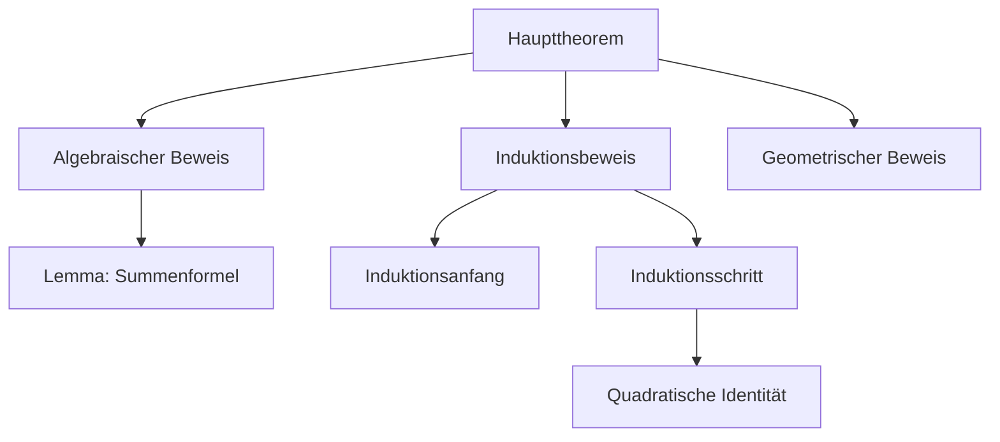
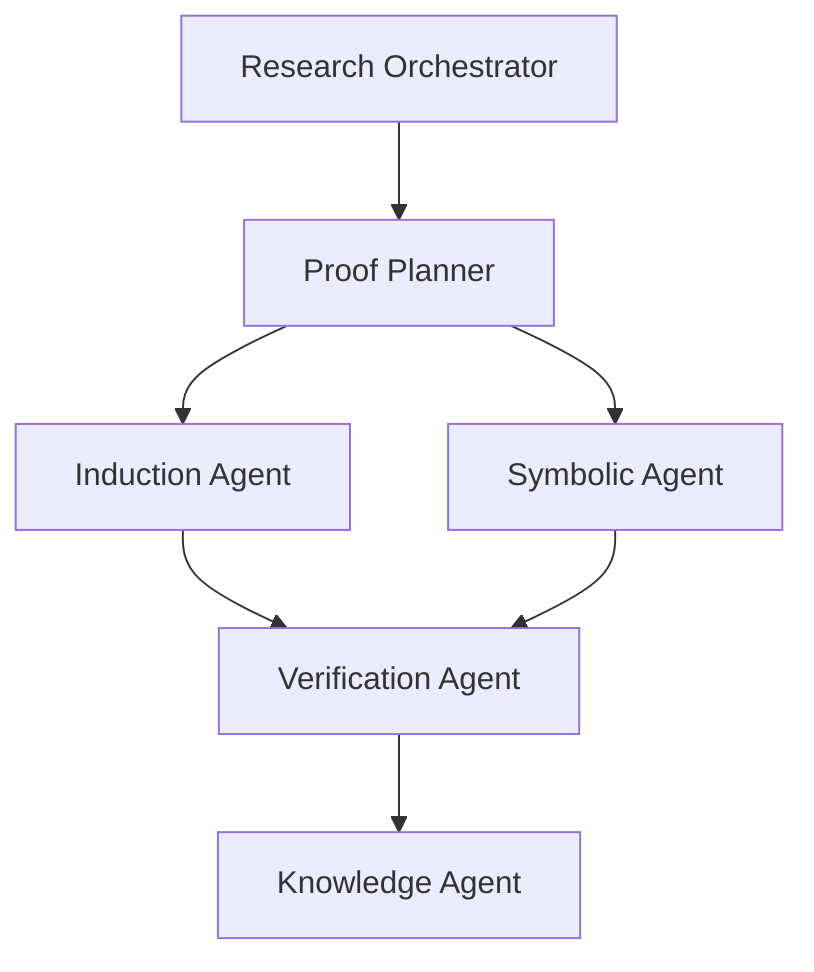
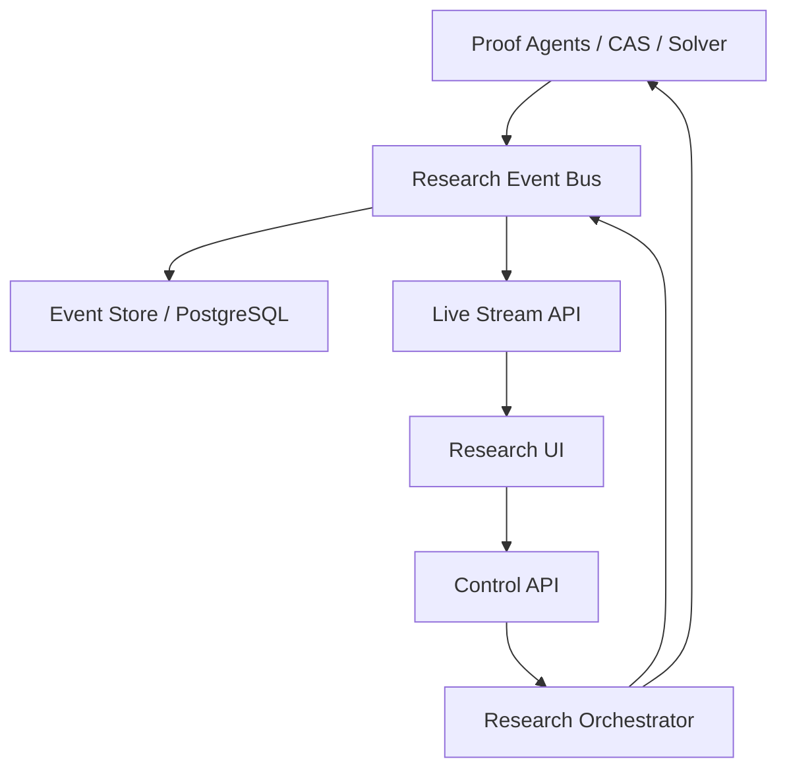

# Mathematical Research Control Center

**Ausführliches UI-/UX- und Frontend-Architekturkonzept für ein autonomes mathematisches Beweissystem**  
**Stand:** 21. November 2026  
**Begleitdokument:** `Mathematisches_Beweissystem_Forschungs_und_Architekturkonzept.md`  
**Geplante Plattformen:** Windows, Linux und optional Web  
**Leitidee:** Live beobachten, mathematisch verstehen, gezielt eingreifen, vollständig wiedergeben.

> Dieses Dokument fasst die im Chat erarbeitete UI-Konzeption zusammen und konkretisiert sie zu einem implementierbaren Architektur- und Feature-Blueprint. Alle gezeigten Zustände, Zahlen und Run-IDs sind Beispielwerte. Die UI wurde mit diesem Dokument noch nicht implementiert.

## Inhaltsverzeichnis

1. [Vision und Leitprinzipien](#1-vision-und-leitprinzipien)
2. [Informationsarchitektur und Navigation](#2-informationsarchitektur-und-navigation)
3. [Live Research Workspace und Layout](#3-live-research-workspace-und-layout)
4. [Proof Search Graph](#4-proof-search-graph)
5. [Agent Execution Graph und Agent Explorer](#5-agent-execution-graph-und-agent-explorer)
6. [Mathematical Knowledge Graph](#6-mathematical-knowledge-graph)
7. [Inspector und mathematische Detailansichten](#7-inspector-und-mathematische-detailansichten)
8. [Echtzeitereignisse und Timeline](#8-echtzeitereignisse-und-timeline)
9. [Replay und historische Zustände](#9-replay-und-historische-zustände)
10. [Aktive Steuerung und Human-in-the-Loop](#10-aktive-steuerung-und-human-in-the-loop)
11. [Simulationen und symbolische Mathematik](#11-simulationen-und-symbolische-mathematik)
12. [Metriken und Dashboards](#12-metriken-und-dashboards)
13. [Weitere Seiten und Funktionen](#13-weitere-seiten-und-funktionen)
14. [Designsystem und UX-Regeln](#14-designsystem-und-ux-regeln)
15. [Frontend- und Echtzeitarchitektur](#15-frontend--und-echtzeitarchitektur)
16. [Event-Schemas und API-Kontrakte](#16-event-schemas-und-api-kontrakte)
17. [Tracing, Observability und Persistenz](#17-tracing-observability-und-persistenz)
18. [Performance, Sicherheit und Zuverlässigkeit](#18-performance-sicherheit-und-zuverlässigkeit)
19. [Technologieauswahl und Plattformstrategie](#19-technologieauswahl-und-plattformstrategie)
20. [MVP, Ausbaustufen und Akzeptanzkriterien](#20-mvp-ausbaustufen-und-akzeptanzkriterien)
21. [Konkrete Entwicklungsaufgaben](#21-konkrete-entwicklungsaufgaben)
22. [Quellen und technische Referenzen](#22-quellen-und-technische-referenzen)

---

## 1. Vision und Leitprinzipien

Das Mathematical Research Control Center ist nicht lediglich ein Monitoring-Dashboard für LLM-Aufrufe. Es ist eine **wissenschaftliche Kontroll- und Forschungsoberfläche**, die den Zusammenhang zwischen mathematischem Problem, Agentenaktivität, Beweissuche, Werkzeugnutzung, Verifikation und Wissensgewinn darstellt.

### 1.1 Kernfragen der Benutzeroberfläche

- Welches mathematische Problem und welche präzise formale Aussage werden bearbeitet?
- Welche Agenten arbeiten an welchen Aufgaben und mit welchen Modellen?
- Welche mathematischen Strategien werden verfolgt?
- Welche Hypothesen und Hilfssätze entstehen?
- Welche Beweiszweige sind erfolgreich, fehlerhaft, offen oder verworfen?
- Welche symbolischen Operationen und numerischen Simulationen werden ausgeführt?
- Welche mathematischen Ergebnisse sind tatsächlich formal verifiziert?
- Welche früheren Erkenntnisse werden wiederverwendet?
- Wie viel Zeit, Tokenbudget, CPU/GPU-Zeit und Speicher werden verbraucht?
- Warum wurde eine bestimmte nächste Aktion ausgewählt?
- Wie kann der Benutzer eine laufende Suche steuern, pausieren oder verändern?
- Wie lässt sich der Verlauf zeitpunktgenau rekonstruieren?

### 1.2 Fünf UX-Prinzipien

1. **Overview:** Gesamtzustand sofort verstehen.
2. **Explore:** In Graphen, Suchzweige und Agentenaktionen hineinzoomen.
3. **Understand:** Mathematische Aussage, Voraussetzungen, Beweis, Fehler und Provenienz nachvollziehen.
4. **Intervene:** Kontrolliert eingreifen, ohne die Historie oder das ursprüngliche Problem zu überschreiben.
5. **Replay:** Jeden relevanten Systemzustand nachträglich rekonstruieren.

### 1.3 Wichtige fachliche Grenze

Die UI darf drei verschiedene Dinge **niemals vermischen**:

| Kategorie | Anzeige | Bedeutung |
|---|---|---|
| Agentenstatus | Laufend, fertig, fehlgeschlagen | Technischer Prozesszustand |
| Mathematischer Befund | Vermutung, numerische Evidenz, symbolisch hergeleitet | Erkenntnis- bzw. Evidenzstatus |
| Formale Verifikation | Verifiziert, offen, abgelehnt | Ergebnis eines vertrauenswürdigen Proof Checkers |

Ein Agent kann technisch erfolgreich abgeschlossen sein, obwohl seine mathematische Vermutung falsch ist. Und ein Ergebnis aus einer Simulation ist keine allgemeine mathematische Beweisführung.

## 2. Informationsarchitektur und Navigation

### 2.1 Hauptseiten

| Seite | Zweck | Priorität |
|---|---|---|
| Research Overview | Projekte, aktive Runs, Warnungen, Erfolgsmetriken | P0 |
| Live Research Workspace | Hauptarbeitsfläche für laufende Agenten und Beweisgraphen | P0 |
| Proof Explorer | Fertige/partielle Beweise, Varianten, Prüfung | P0 |
| Agent Explorer | Hierarchie, Aktionen, Modelle, Aufträge, Tools | P0 |
| Experiment Laboratory | Symbolik, Simulationen, Parameterstudien, Gegenbeispiele | P1 |
| Mathematical Knowledge Graph | Theoreme, Definitionen, Gleichungen, Methoden, Beziehungen | P1 |
| Model & Benchmark Laboratory | Modelle, Golden Tasks, Trainings-/Evaluationsvergleiche | P1 |
| Research Reports | Dokumentation und Exporte | P1 |
| Workflow Builder | Agentenabläufe und Bedingungen visuell konfigurieren | P2 |
| System Configuration | Provider, Methoden, Prompts, Budgets, Berechtigungen | P1 |

### 2.2 Linke globale Navigation

Empfohlene Einträge:

```text
Research
  Overview
  Active Runs
  Problems
  Proof Explorer

Knowledge
  Theorems & Lemmas
  Knowledge Graph
  Methods

Laboratory
  Experiments
  Simulation
  Models & Benchmarks

System
  Agents
  Workflows
  Settings
```

Die globale Navigation bleibt stabil; innerhalb eines Forschungsruns erfolgt die Navigation zwischen graphischen Teilansichten durch Tabs oder Segmented Controls.

## 3. Live Research Workspace und Layout

### 3.1 Bildschirmkomposition

Die Hauptseite soll aus fünf funktionalen Zonen bestehen:

| Zone | Position | Inhalt |
|---|---|---|
| Global Navigation | Außen links | Projekte, Probleme, Forschungsbereiche |
| Agent Explorer | Linkes Panel | Agentenliste, Aufgabe, Modell, Status, Budget |
| Research Canvas | Zentrale Fläche | Beweisgraph, Agenten-Ausführungsgraph oder Wissensgraph |
| Detail Inspector | Rechtes Panel | Details zum markierten Element und Aktionen |
| Timeline & Console | Unterer ausklappbarer Bereich | Events, Log, Solver-Ausgaben und Replay |

**Desktop-Verteilung:** Research Canvas ca. 50–60 % der nutzbaren Breite; Seitenpanels je nach Fenstergröße einklappbar. Die untere Timeline soll in der Höhe veränderbar sein.

### 3.2 Kopfbereich eines Forschungsruns

Anzeigen:

- Problemname, Run-ID und Arbeitsmodus (z. B. Blind Rediscovery)
- Natürliche Zielaussage und aufklappbare Formalisierung
- Run-Status: Running, Paused, Completed, Failed, Cancelled
- Gesamtbudget und verbleibende Zeit
- Anzahl aktiver Agenten, Suchversuche, verifizierter Lemmas und offener Ziele
- Steuerung: Pause, Resume, Stop, Export, Run vergleichen
- Deutliche Anzeige, ob Live-Ansicht oder historisches Replay geöffnet ist

### 3.3 Beispiel für die aktuelle Forschungsansicht

**Forschungsziel:**

\[
\sum_{k=1}^{n}(2k-1)=n^2.
\]

**Illustrative Statuskarten:**

| Kennzahl | Beispielwert |
|---|---:|
| Aktive Agenten | 4 |
| Suchversuche | 128 |
| Formal verifizierte Lemmata | 12 |
| Offene Teilziele | 3 |
| Run-Zustand | Running |

**Linkes Panel:** Proof Planner aktiv, Induction Agent aktiv, Symbolic Agent abgeschlossen, Lean Verifier prüft.  
**Zentral:** Zielaussage mit algebraischem, induktivem und geometrischem Suchzweig.  
**Rechts:** Ausgewähltes Teilziel \((n+1)^2=n^2+2n+1\), Methode `ring`, Verifikationsstatus.  
**Unten:** Zeitstempel, Agent, Eventtyp und Kurzbeschreibung der jüngsten Ereignisse.

## 4. Proof Search Graph

Der Proof Search Graph ist das **fachliche Herzstück** der UI. Er unterscheidet Beweissuche von Agentenexecution.

### 4.1 Struktur des Beweisgraphen



Die tatsächliche Datenstruktur muss **AND-/OR-Beziehungen** modellieren:

- `OR`: Alternative Beweisstrategien; eine erfolgreiche Variante kann genügen.
- `AND`: Mehrere Teilziele; alle sind nachzuweisen.
- `DEPENDS_ON`: Ein Schritt beruht auf einem bereits etablierten Lemma.
- `REUSES`: Ein verifiziertes Lemma wird in mehreren Zweigen angewendet.
- `REFUTES`: Ein Gegenbeispiel widerlegt eine vermutete Aussage.

Damit wird der Suchgraph eher ein gerichteter Hypergraph als nur ein einfacher Baum.

### 4.2 Darstellung der Proof-Knoten

Ein Knoten zeigt kompakt:

- Kurztitel bzw. formale Zielaussage
- Strategie/Methode
- Verifikations- und Arbeitsstatus
- Anzahl offener Teilziele
- Priorität und optional geschätzte Lösbarkeit
- Agent und Zeitpunkt letzter Änderung

Im Zoom-Out-Modus werden nur Titel, Knotenart und Status dargestellt. Bei näherem Zoom erscheinen mathematische Details.

### 4.3 Knotenstatus

| Status | Farbe/Icon | Bedeutung |
|---|---|---|
| `VERIFIED` | Grün / Check | Lean oder anderer vertrauenswürdiger Prüfer hat Ziel akzeptiert |
| `RUNNING` | Blau / Spinner | Agent arbeitet an diesem Teilziel |
| `WAITING` | Gelb / Uhr | Wartet auf Voraussetzungen oder Ressourcen |
| `FAILED` | Rot / Kreuz | Konkreter Versuch ist gescheitert |
| `CONJECTURED` | Violett / Glühbirne | Noch unbewiesene Hypothese |
| `ABANDONED` | Grau / Archiv | Suchzweig bewusst beendet |
| `REFUTED` | Dunkelrot / Gegenbeispiel | Zielaussage ist widerlegt |

Immer Statuslabel und Icon verwenden; Farbe darf nicht die einzige Information sein.

### 4.4 Interaktionen

- Klick: Knoten im Inspector öffnen.
- Doppelklick: Fokus auf Teilgraph setzen.
- Kontextmenü: Neue Strategie, Priorität ändern, Agent zuweisen, neue Exploration.
- Rechtsklick/Details: Tactic-Log, Proof State, Lean-Code, Quellen, Axiome.
- Ein-/Ausklappen: Teilziele und untergeordnete Suchzweige.
- Filter: Methode, Agent, Status, Verifikationsgrad, Zeitfenster.
- Layout: Hierarchisch, nach Methode, nach Zeit, nach Abhängigkeit.
- Vergleich: Alternative Beweise desselben Ziels nebeneinander ansehen.

**Sicherheitsprinzip:** Über UI-Klicks kann ein Mensch einen Suchzweig priorisieren, aber nicht ohne einen formalen Prüfnachweis auf `VERIFIED` setzen.

## 5. Agent Execution Graph und Agent Explorer

Dieser Graph zeigt die **operative Ausführung** und nicht die mathematische Beweislogik.

### 5.1 Beispiel



Kanten repräsentieren Auftrag, Ergebnis, Datenfluss und Abhängigkeit. Eine mathematische Abhängigkeit darf nicht allein daraus abgeleitet werden, dass zwei Agenten Nachrichten austauschen.

### 5.2 Agentenkarte

Anzeigen:

- Agenten-ID und Rolle
- Aktuelle Task-ID und mathematisches Ziel
- Modellname, Version, Temperatur/Inference-Konfiguration
- Laufstatus und Startzeit
- Tokenverbrauch, Dauer, Ressourcen
- Letzter Toolaufruf
- Anzahl generierter und formal verifizierter Teilziele
- Aktuelle Arbeitsphase und offene Tool-Ergebnisse

### 5.3 Agentenaktionen

- Details und eigene Timeline öffnen.
- Laufenden Auftrag pausieren oder kontrolliert abbrechen.
- Neuen Folgetask erstellen.
- Strategie, Modell oder Ressourcenbudget **für einen neuen Versuch** ändern.
- An Agenten einen expliziten mathematischen Hinweis übergeben.
- Fehlgeschlagene Aktionen mit geändertem Kontext erneut ausführen.

Die Agentensteuerung sollte eine getrennte Control API nutzen und sämtliche Aktionen protokollieren.

## 6. Mathematical Knowledge Graph

Der Wissensgraph visualisiert mathematische **Beziehungen über mehrere Probleme und Runs hinweg**.

### 6.1 Knotentypen

`Problem`, `FormalStatement`, `Theorem`, `Lemma`, `Definition`, `Equation`, `Expression`, `ProofMethod`, `Concept`, `Proof`, `Counterexample`, `Experiment`, `Publication`.

### 6.2 Beziehungstypen

```text
DEPENDS_ON
USES_THEOREM
IS_EQUIVALENT_TO
IMPLIES
GENERALIZES
IS_SPECIAL_CASE_OF
USES_PROOF_METHOD
HAS_COUNTEREXAMPLE
PROVEN_BY
SIMILAR_TO
DERIVED_FROM
REQUIRES_ASSUMPTION
```

Wesentlich ist, formale Beziehungen von semantischen Ähnlichkeiten zu unterscheiden. Ein Retrieval-Modell darf vermutete Analogien erzeugen, die UI muss diese aber als **nicht verifiziert** kennzeichnen.

### 6.3 Interaktionen

- Von einem Beweisknoten zu seinem mathematischen Lemma springen.
- Verwendete und mögliche Premises hervorheben.
- Abhängigkeitskette bis zu Definitionen/Axiomen verfolgen.
- Alle anderen Probleme anzeigen, die ein Lemma wiederverwenden.
- Alternative Herleitungen und Verallgemeinerungen anzeigen.
- Unverifizierte, neue Beziehungen als Hypothesen markieren.
- Graph nach Fachgebiet, Herkunft, Verifikation und Zeitraum filtern.

## 7. Inspector und mathematische Detailansichten

Der rechte Inspector ist **kontextsensitiv**: Sein Inhalt hängt von der Auswahl im Canvas ab.

### 7.1 Inspector für Beweisschritte

1. Mathematische Zielaussage als LaTeX.
2. Formale Lean-Aussage und zugehörige Hypothesen.
3. Verwendete Methode, Taktik und Parameter.
4. Proof State vor und nach dem Schritt (Diff).
5. Verwendete Lemmata inklusive Provenienz.
6. Formale Verifikationsausgabe und Fehlermeldungen.
7. Agent, Modell und Toolversionen.
8. Verbrauchte Ressourcen und Anzahl lokaler Retries.
9. Alternative bekannte Fortsetzungen.
10. Verknüpfungen zu Wissensgraph und Timeline.

### 7.2 Inspector für mathematische Hypothesen

- Ursprünglicher Wortlaut und formale Version.
- Definitionsbereiche und Voraussetzungen.
- Experimentelle Evidenz und Fälle.
- Gefundene Gegenbeispiele.
- Noch fehlende formale Beweispflichten.
- Verwandte bekannte Theoreme.

### 7.3 Inspector für Agenten

- Rolle, Toolrechte, Modellversion, Auftrag.
- Zeitlicher Verlauf von Subtasks und Toolaufrufen.
- Verwendeter Kontext und abgerufene Lemmas.
- Explicite Planungsartefakte und Begründungszusammenfassungen.
- Technische Fehler und Retry-Historie.

**Wichtig:** Die UI darf keine unzugänglichen internen Gedankenketten eines KI-Modells als tatsächlichen Live-Mitschnitt behaupten. Sichtbar gemacht werden zuverlässig verfügbare, strukturierte Pläne, Modelloutputs, Werkzeugeingaben/-ausgaben und formale Artefakte.

## 8. Echtzeitereignisse und Timeline

### 8.1 Event-Beispiele

| Event | UI-Aktualisierung |
|---|---|
| `agent.started` | Agentenkarte aktiv, neue Ausführungs-Spans |
| `hypothesis.created` | Neuer violetter Hypothesenknoten |
| `strategy.selected` | Methode in der Suche sichtbar |
| `proof.branch.created` | Suchgraph verzweigt sich |
| `proof.goal.created` | Neues untergeordnetes Ziel |
| `proof.step.proposed` | Taktikkandidat wird angezeigt |
| `proof.step.verified` | Knoten wird formal bestätigt |
| `proof.step.rejected` | Fehlerindikator und Fehlermeldung |
| `lemma.verified` | Verifiziertes Lemma im Graphen |
| `symbolic.calculation.completed` | Formeltransformation im Workspace |
| `simulation.sample.received` | Zeitreihe/Plot aktualisiert |
| `counterexample.found` | Widerlegungswarnung und Link |
| `budget.updated` | Ressourcenanzeige verändert sich |
| `run.paused` | Live-Zeitmarke und Status pausiert |
| `run.completed` | Endstatus und Ergebnisübersicht |

### 8.2 Timeline-Ansichten

**Chronologisch:** Alle Ereignisse in einer globalen Zeitleiste.  
**Nach Agent:** Swimlanes mit je einer Zeile pro Agent.  
**Nach Suchzweig:** Nur zu einem Beweisweg gehörende Events.  
**Nach Verifikation:** Validierungen, ungültige Schritte, Axiomkontrollen.  
**Nach Tool:** Lean-, CAS-, SMT-, Simulation- und Datenbankaufrufe.

### 8.3 Timeline-Filter

- Agent-ID
- Eventtyp
- Severity
- Proof Node
- Zeitraum
- Verifikationsstatus
- Methode
- Modellversion
- Fehlerklasse

Ein Klick auf ein Event sollte den zugehörigen Knoten in allen geöffneten Ansichten hervorheben.

## 9. Replay und historische Zustände

### 9.1 Interaktiver Zeitregler

Die UI erhält einen Slider, der einen gespeicherten Run zeitpunktweise rekonstruiert.

Beispielhistorie:

| Zeit | Ereignis | Zustand |
|---|---|---|
| 00:00 | Problem eingelesen | Formalisierung startet |
| 00:12 | Strategien erzeugt | Drei Varianten geplant |
| 00:25 | Agenten gestartet | Parallel laufende Suche |
| 00:42 | Basisfall verifiziert | Formaler Teilfortschritt |
| 00:44 | Neuer Zweig | Induktionsschritt wird zerlegt |
| 00:53 | Verifikationsfehler | Fehlende Voraussetzung |
| 01:05 | Reparatur erfolgreich | Ziel formal geprüft |

### 9.2 Replay-Verhalten

Während des Verschiebens des Zeitreglers sollen synchron rekonstruierbar sein:

- Agentenstatus und Aufträge
- Beweisgraph und offene Teilziele
- Zu diesem Zeitpunkt bekannte Hypothesen
- Frühere Fehler und Gegenbeispiele
- Zugeordnete Modell- und Toolversionen
- Metriken und Ressourcenverbrauch
- Wissensgraph-Änderungen

### 9.3 Technische Umsetzung

- Alle relevanten Events append-only speichern.
- Eventsequenz pro Run monoton nummerieren.
- Regelmäßige konsistente Snapshots für schnellen Replay-Start.
- Von einem Snapshot aus nachfolgende Events deterministisch anwenden.
- Historische UI-Zustände zunächst schreibgeschützt darstellen.
- `Fork from Here` erzeugt einen neuen Run mit Provenienz auf historischen Zustand und konkreter Konfiguration.
- Direkte historische Datenmutation ist nicht erlaubt.

## 10. Aktive Steuerung und Human-in-the-Loop

### 10.1 Aktionen

| Ebene | Aktion | Semantik |
|---|---|---|
| Run | Start / Pause / Resume / Stop | Zustandswechsel durch Orchestrator |
| Suchzweig | Priorität erhöhen / senken | Budgetumverteilung |
| Suchzweig | Neue Methode hinzufügen | Neue branch-ID mit eigenem Versuch |
| Agent | Neuen Folgetask senden | Neue versionierte Anweisung |
| Agent | Alternativmodell ausprobieren | Neuer Agentenrun, unveränderte Historie |
| Teilziel | Mathematischen Hinweis geben | Benutzerhinweis als Evidenz speichern |
| Lemma | Erneut überprüfen | Neuer Verifikationslauf |
| Experiment | Parameter ändern | Neue Experimentversion |
| Beweis | Alternativen vergleichen | Vergleichsansicht öffnen |
| Historischer Zustand | Fork / Re-Run | Neuer abgeleiteter Run |

### 10.2 Kontrollierte Kommandos

Jedes Kommando benötigt mindestens:

- `command_id` für Idempotenz
- `run_id`, optional `branch_id`, `agent_id`, `proof_node_id`
- `requested_by`
- `expected_state_version` zur Erkennung von Race Conditions
- Aktionstyp und Parameter
- Serverbestätigung oder begründeten Fehler
- Audit-Event und neuen Zustandsstand

Eine UI-Schaltfläche zeigt erst dann „pausiert“ an, wenn das Backend die Statusänderung bestätigt hat. Potenziell kostspielige oder destruktive Aktionen wie Run-Abbruch müssen bestätigungsbedürftig sein.

### 10.3 Beispielinteraktion

Benutzer klickt auf `Induktionsschritt` und wählt:  
**„Diesen Zweig weiter untersuchen“**.  
Parameter: zusätzliche algebraische Hilfssätze, neues Modell, 15 Minuten Budget.

Der Orchestrator erzeugt einen neuen verknüpften Versuch, statt den vorhandenen Beweisverlauf zu überschreiben.

## 11. Simulationen und symbolische Mathematik

### 11.1 Symbolic Workspace

- Mathematische Ausdrücke in schön gesetztem LaTeX.
- Formelumformungen schrittweise anzeigen.
- Transformationsquelle: SymPy, SageMath, Lean oder eigener Algorithmus.
- Variablentypen, Voraussetzungen und Definitionsbereiche sichtbar halten.
- Rechnungen als Pipeline mit Zwischenergebnissen darstellen.
- Wenn möglich verifizierte und nur symbolisch berechnete Resultate unterscheiden.

### 11.2 Simulation Workspace

- Live-Plots mit wählbaren Parametern.
- Zeitreihen, Parameterflächen, Nullstellen, Diskontinuitäten und Extremwerte.
- Mehrere Simulationsläufe und Seeds nebeneinander vergleichen.
- Gefundene Gegenbeispiele markieren und exportieren.
- Rechenpräzision und numerische Toleranzen darstellen.
- Simulationsbedingungen und generierende Modellversion abrufen.

### 11.3 Beispiel

Untersuche:

\[
f(x,\alpha)=x^3-\alpha x+1.
\]

Ein Agent variiert \(\alpha\); die UI zeigt Nullstellen, Kandidaten kritischer Parameter und neue Vermutungen. Symbolik und formale Prüfung erhalten separate Events und Vertrauensstatus.

## 12. Metriken und Dashboards

### 12.1 Run-Kennzahlen

- Aktive und abgeschlossene Agenten
- Proof Attempts und Search Branches
- Formal verifizierte Lemmas und Beweise
- Offene Teilziele / Proof Obligations
- CPU-, GPU-, Speicher- und Tokenverbrauch
- Time to First Valid Lemma / Time to Proof
- Solver-Fehlerrate und Retry-Anzahl
- Geschätzte Lösbarkeit des aktuellen Suchzustands

### 12.2 Wissenschaftliche Qualitätsmetriken

| Metrik | Visualisierung | Bemerkung |
|---|---|---|
| Formal Success | Eindeutiger Verifikationsstatus | Kein geschätzter Prozentwert |
| Pass@k | Benchmark-Balken/Trend | Vergleich nur bei gleichem Budget |
| Cost per Proof | Zeitreihe oder Vergleich | Run- und Modellkosten |
| Proof Length | Balken/Histogramm | Beweislänge ist kein Wahrheitskriterium |
| Proof Diversity | Methoden- und Strukturvergleich | Unterschiedliche Texte sind nicht zwingend andere Beweise |
| Value Estimate | Zeitreihe mit Unsicherheit | Modellschätzung, keine Gewissheit |
| Premise Recall@k | Retrieval-Benchmark | Daten- und Abfrageversion angeben |
| Transfer Success | Vergleich nach Problemfamilien | Neuheit/Leakage beachten |
| Knowledge Reuse | Abhängigkeitsgraph und Zähler | Nur echte Wiederverwendung zählen |

Die UI darf keinen scheinbar objektiven **„Beweis zu 85 % fertig“**-Wert anzeigen, wenn dafür nur eine schlecht kalibrierte Heuristik existiert. Besser: offene Ziele, nachweislich bewiesene Teilziele und separat als Schätzung gekennzeichnete Lösbarkeit.

## 13. Weitere Seiten und Funktionen

### 13.1 Research Overview

Globale Liste aller Forschungsprojekte und Probleme mit Status, Datum, Agentenaktivität, letzter Erkenntnis, Kosten, Benchmark und Handlungsempfehlung.

### 13.2 Proof Explorer

Vergleich mehrerer formal geprüfter Beweise desselben Theorems. Unterschiede bei verwendeten Hilfssätzen, Methoden, Länge, Laufzeit, Verständlichkeit und Wiederverwendbarkeit.

### 13.3 Model & Benchmark Laboratory

Vergleich von Modellversionen, Prompt-/Strategievarianten, Golden Tasks, Ablationsläufen, Trainingsläufen und Ressourcen. Unterstützung für reproduzierbare A/B-Experimente.

### 13.4 Research Reports

Versionierte Exporte als Markdown, LaTeX, PDF und Lean-Quellen mit:

- Ursprünglicher Problemdefinition
- Endgültiger formaler Zielaussage
- Verwendeten Definitionen und Beweismethoden
- Prüfstatus und Axiomreport
- Mathematischen Erklärungen
- Diagrammen und Simulationen
- Referenzierten Quellen
- Durchgeführten Versuchen und Ergebnisvergleich

### 13.5 Workflow Builder (später)

Visueller Editor für Startbedingungen, Modelle, Strategien, Agenten, Tools, Prüfschritte, Fehler-Workflows und Budgetlimits. Das Builder-Layout soll klar vom **Proof Graph** abgegrenzt sein: Workflow-Kanten beschreiben Aufgabensteuerung, keine mathematischen Implikationen.

## 14. Designsystem und UX-Regeln

### 14.1 Visuelle Richtung

Empfohlen: wissenschaftliches Desktop-Werkzeug mit reduziertem, professionellem Interface. Dunkel- und Hellmodus; große zentrale Arbeitsfläche; wenig dekorative Animation; konsistente Typografie.

### 14.2 Design Tokens

- **Primary:** Blau – aktive Prozesse und ausgewählte Elemente.
- **Success:** Grün – formal verifizierte Ergebnisse.
- **Warning:** Gelb/Orange – wartend, nicht abgeschlossen, prüfungsbedürftig.
- **Danger:** Rot – Fehlschläge und formale Widerlegungen.
- **Discovery:** Violett – Vermutungen und noch unverifizierte Erkenntnisse.
- **Neutral:** Grau – Archiv, ruhende Systeme, Hintergrund.

Farben müssen stets um Labels, Icons und barrierefreie Kontraste ergänzt werden.

### 14.3 Adaptive Detailtiefe

- **Overview:** Top-Level-Probleme, Methoden, Agentenzustände.
- **Explore:** Teilziele, verwendete Lemmas und Untergraphen.
- **Inspect:** Lean-Taktiken, Input/Output, Versionskontext und Fehler.

Zoom und Kontextwechsel sollen vorhandene Informationen nicht löschen, sondern den Detaillierungsgrad ändern.

### 14.4 UX-Regeln

- Fixierte, gut lesbare mathematische Notation.
- Suche und Filter immer verfügbar.
- Selektionszustand beim Wechsel zwischen Ansichten erhalten.
- Kein endlos blinkender Graph; Aktualisierungen visuell dosieren.
- Mehrfachaktionen bestätigen und Backend-Acknowledgment abwarten.
- Live- und Replay-Modus deutlich voneinander unterscheiden.
- Auflösung von Fehlermeldungen und mathematischen Voraussetzungen mit wenigen Klicks.
- Exportierbare Ansichten für Dokumentation und wissenschaftliche Publikationen.

## 15. Frontend- und Echtzeitarchitektur

### 15.1 Architekturdiagramm



### 15.2 Datenkanäle

| Kanal | Empfehlung | Anwendungsfall |
|---|---|---|
| Backend → Frontend | Server-Sent Events (SSE) | Live-Events, Statusupdates |
| Frontend → Backend | REST | Run-/Agentenbefehle, Artefaktabfragen |
| Bidirektional, wenn nötig | WebSockets | Interaktive Steuer- oder Kollaborationsszenarien |
| Interne Backend-Kommunikation | Event Bus / Queue | Agentenergebnisse, Solver-Events |
| Persistence | PostgreSQL + Artefaktspeicher | Historie, Snapshots, Beweisterme |

FastAPI dokumentiert SSE und WebSockets. Für den MVP ist **SSE für den Eventstrom plus REST für Steuerkommandos** eine übersichtliche Implementierung. WebSockets werden erst eingesetzt, wenn die konkrete Interaktion dies benötigt.

### 15.3 Frontend-State-Management

Zustände voneinander trennen:

1. **Server State:** Run, Agenten, Proof Nodes, verifizierte Ergebnisse.
2. **Event Projection:** Live-Stream-Rekonstruktion aus Events.
3. **View State:** Zoom, Auswahl, aktive Filter, Panelbreiten.
4. **Interaction State:** Offene Dialoge, unbestätigte Aktionen.
5. **Replay State:** Historischer Zeitpunkt und Snapshotversion.

Der Server ist für mathematische und operative Fakten maßgeblich; Frontend-Zustände dürfen keine verifizierten Ergebnisse erfinden.

## 16. Event-Schemas und API-Kontrakte

### 16.1 Beispielevent

```json
{
  "event_id": "evt-008421",
  "sequence": 142,
  "timestamp": "2026-11-21T14:32:16Z",
  "type": "proof.step.verified",
  "run_id": "run-0042",
  "problem_id": "problem-0007",
  "agent_id": "induction-agent-01",
  "trace_id": "trace-8021",
  "parent_event_id": "evt-008419",
  "payload": {
    "proof_node_id": "node-0045",
    "method": "mathematical_induction",
    "verification_engine": "lean4",
    "verification_status": "VERIFIED",
    "duration_ms": 127
  }
}
```

### 16.2 Technische Pflichtfelder

`event_id`, `sequence`, `timestamp`, `type`, `schema_version`, `run_id`, `trace_id`, `payload`. Je nach Event zusätzlich `problem_id`, `agent_id`, `proof_node_id`, `parent_event_id`, `verification_artifact_id`, `privacy_classification`.

### 16.3 Commands

```json
{
  "command_id": "cmd-00119",
  "type": "branch.investigate",
  "run_id": "run-0042",
  "branch_id": "branch-induction-03",
  "requested_by": "user",
  "expected_state_version": 35,
  "parameters": {
    "strategy": "algebraic_lemmas",
    "max_runtime_seconds": 900,
    "model_profile": "local_prover"
  }
}
```

### 16.4 API-Entwurf (illustrativ)

| Methode/Pfad | Aufgabe |
|---|---|
| `GET /runs` | Run-Liste und Filter |
| `GET /runs/{id}` | Run-Metadaten und aktueller Zustand |
| `GET /runs/{id}/snapshot` | Konsistenter Snapshot |
| `GET /runs/{id}/events?after=142` | Event-Nachladung |
| `GET /runs/{id}/stream` | SSE-Live-Feed |
| `POST /runs/{id}/commands` | Run-/Agentensteuerung |
| `GET /runs/{id}/proof-graph` | Beweisknoten und Abhängigkeiten |
| `GET /runs/{id}/agent-graph` | Operativer Ausführungsgraph |
| `GET /proof-nodes/{id}` | Details und Verifikationsstatus |
| `GET /artifacts/{id}` | Lean-Code, Logs, Simulationen |
| `GET /knowledge/search` | Theorem-/Lemma-Suche |

API-Schema von Beginn an versionieren; große Beweisterme und Logs nicht vollständig durch den Live-Stream schicken, sondern auf Artefakt-IDs verweisen.

## 17. Tracing, Observability und Persistenz

### 17.1 Zwei unterschiedliche Tracing-Dimensionen

**Technisches Tracing:** Agenten-Calls, Toolaufträge, Queuezeiten, API-Aufrufe, Retries, Modellkosten, Fehler.  
**Mathematisches Tracing:** Hypothesen, Formalisierungen, Proof States, Lemmas, Strategien, Gegenbeispiele, Verifikationsartefakte.

OpenTelemetry kann den technischen Ausführungsverlauf über Traces, Spans und strukturierte Events korrelieren. Langfuse bietet zusätzliche observability-orientierte Agenten-, Session-, Graph- und Timeline-Ansichten. Beide ersetzen jedoch **nicht** das eigene mathematische Domänenmodell.

### 17.2 Persistenzprinzipien

- Append-only Event-Log für vergangene Aktivitäten.
- Konsistente Zustandssnapshots für schnellen UI-Neustart und Replay.
- Separate Speicherung großer Artefakte; Referenzen in Events.
- Serverseitig verifizierte Reihenfolge pro Run.
- Idempotente Eventverarbeitung und Commandbehandlung.
- Wiederaufbau nach Verbindungsabbrüchen anhand der letzten Eventsequenz.
- Unveränderliche Provenienz für verifizierte Mathematik.

## 18. Performance, Sicherheit und Zuverlässigkeit

### 18.1 Große Graphen

- Nur sichtbare Knoten rendern.
- Teilgraphen per Standard zunächst zusammenfassen.
- Adaptive Level of Detail abhängig von Zoom.
- Graphänderungen als Deltas statt Gesamtdaten übertragen.
- Layoutberechnung inkrementell oder im Hintergrund.
- UI-Updates bei hoher Eventrate aggregieren, **aber alle Originalevents persistieren**.
- Virtuelle Listen für viele Agenten, Events und Logs.
- Artefakte und Proof States erst bei Auswahl laden.

### 18.2 Fehlerfälle

| Fehler | UI-Verhalten |
|---|---|
| SSE getrennt | Wiederverbindung, verpasste Events laden |
| Agent abgestürzt | Sichtbaren Fehlerstatus und letzte bekannte Aktivität zeigen |
| Verifier nicht verfügbar | Prüfstatus offen/unterbrochen statt gültig anzeigen |
| Commands gleichzeitig | Versionskonflikt melden; neuesten Zustand nachladen |
| Große Events | Payload im Artefaktspeicher, nur ID im Stream |
| Backend-Neustart | Snapshot laden und Eventsequenz fortsetzen |
| Replay aufgelöst | Historischen Zustand lesend halten |

### 18.3 Sicherheit

- Keine direkten Datenbankmutationen durch die UI.
- Rollen und Berechtigungen für Start, Stop, Budgetänderung und Toolrechte.
- Generierten Code isoliert ausführen.
- Keine Secrets in Eventlogs, Modellprompts oder UI-Artefakten ausgeben.
- Ausführungsbefehle auditieren und eindeutig bestätigen.
- Externe Paper-/Tooldaten als nicht vertrauenswürdig behandeln.
- Schutz vor unkontrolliertem Ressourcenverbrauch durch Benutzeraktionen.

## 19. Technologieauswahl und Plattformstrategie

| Bereich | Empfehlung | Bemerkung |
|---|---|---|
| UI | React + TypeScript | Sehr gute graphische Bibliotheken |
| Flow- und Proof-Graph | [React Flow](https://reactflow.dev/) | Custom Nodes, Kanten, Zoom und Selektion |
| Knowledge Graph | [Cytoscape.js](https://js.cytoscape.org/) | Komplexe Netzwerkansichten |
| Diagramme | Plotly | Simulationen und Metriken |
| Mathematische Darstellung | KaTeX / MathJax | Formeln und Proof States |
| Editor | Monaco Editor | Lean-Code und Logs |
| Backend | Python + FastAPI | APIs und SSE/WebSocket |
| Datenhaltung | PostgreSQL | Runs, Events, Graphdaten |
| Technisches Tracing | [OpenTelemetry](https://opentelemetry.io/docs/concepts/signals/traces/) | Verknüpfte Laufzeitspans |
| LLM-/Agentenmonitoring | [Langfuse](https://langfuse.com/docs/) | Ergänzende Agentenobservability |
| Desktop-Verteilung | React in Desktop-Wrapper oder Flutter-Shell | Windows/Linux |

### 19.1 Empfehlung für die bestehenden Flutter-Projekte

Die einfachste Forschungsvariante ist zunächst ein **lokales React-/TypeScript-Frontend**, das über FastAPI mit den mathematischen Engines kommuniziert. Hier können React Flow, Cytoscape.js und Plotly direkt verwendet werden.

Alternativ lässt sich langfristig ein Flutter-Desktop-Client als äußere Shell einsetzen, während besonders komplexe interaktive Graphen als eingebettete Webflächen dargestellt werden. Eine komplette Neuimplementierung solcher Graphfunktionen in Flutter wäre nur dann sinnvoll, wenn deren Vorteile die zusätzlichen Kosten rechtfertigen.

### 19.2 Performance-Hinweis

Die React-Flow-Dokumentation empfiehlt beispielsweise memoisierten Komponentenaufbau und die Vermeidung unnötiger Graph-State-Subscriptions. Bibliotheksversionen sollten in der Anwendung fixiert werden, weil sich APIs und Performance-Details verändern können.

## 20. MVP, Ausbaustufen und Akzeptanzkriterien

### Stufe 1 – Live Research Workspace (MVP)

**Enthalten:**

- Run-Header, Problem, Status und Budget.
- Agentenliste mit aktuellen Aufgaben.
- Interaktiver Proof Search Graph.
- Inspector mit mathematischer Aussage, Lean-Code, Ergebnissen.
- Event-Timeline und Filter.
- Pause, Resume, Stop über bestätigte Backendkommandos.
- Persistente Events und vollständiger Replay eines Demo-Runs.

**Akzeptanzkriterien:**

1. Ein Agentenevent erscheint während der Ausführung in der Timeline.
2. `proof.step.verified` aktualisiert den verknüpften Beweisknoten.
3. Der Inspector zeigt für jeden Schritt Provenienz und Verifikationsstatus.
4. Ein Browser-/Client-Neustart verliert keine abgeschlossenen Events.
5. Replay erzeugt denselben historischen UI-Zustand aus Snapshot und Eventfolge.
6. Pausieren und Fortsetzen werden serverseitig bestätigt und vollständig protokolliert.
7. Nicht geprüfte Lemmata sind niemals als formal bewiesen dargestellt.

### Stufe 2 – Research Intelligence

**Enthalten:** Wissensgraph, Simulationen, Proof-Vergleiche, Modellmetriken, Agentenvergleiche, Graphfilter, Suchzweig-Priorisierung, zusätzliche Exporte.

**Akzeptanzkriterien:**

- Ein verifiziertes Lemma ist zwischen Proof- und Knowledge-Graph auffindbar.
- Zwei unterschiedliche Beweise desselben Zielstatements können verglichen werden.
- Die Simulation zeigt Parameter, Modell, Seed, Präzision und Ergebnisstatus.
- Eine Benutzeranweisung für einen neuen Suchzweig erzeugt einen neuen, auditierbaren Attempt.

### Stufe 3 – Visual Research Orchestration

**Enthalten:** Workflow-Editor, dynamische Strategieregeln, Agenten-/Modellkonfiguration, Benchmarkautomatisierung, adaptive Budgetsteuerung, komplexe Forschungsvisualisierung.

**Akzeptanzkriterien:**

- Ein Workflow kann visuell erstellt, validiert, versioniert und reproduzierbar ausgeführt werden.
- Änderungen an Workflows und Agentenprofilen werden gegen feste Golden Tests verglichen.
- Budgetentscheidungen und Strategieänderungen sind nachvollziehbar.

## 21. Konkrete Entwicklungsaufgaben

### Epic UI-01 – Domain Event Pipeline

- [ ] Einheitliches Pydantic-/JSON-Schema für Run-, Agent-, Proof- und Verifikationsevents.
- [ ] Append-only Event Store mit Run-Sequenznummern.
- [ ] SSE-Endpoint und Replay-Nachladung.
- [ ] State-Snapshots und Idempotenz.
- [ ] Integrationstests für Reconnect und verlorene Events.

### Epic UI-02 – Research Shell

- [ ] Navigationslayout und Panelverwaltung.
- [ ] Run-Auswahl und Problem-Header.
- [ ] Statuskarten, Runtime und Budgets.
- [ ] Light-/Dark-Mode, Design Tokens, responsives Layout.

### Epic UI-03 – Proof Graph

- [ ] Domainmodell für AND-/OR-Goals.
- [ ] Custom Node Components und Statusfarben.
- [ ] Zoom, Pan, Filter, Collapse, Layouts.
- [ ] Graph-Deltas aus Eventstream.
- [ ] Auswahl-Synchronisierung mit Inspector.
- [ ] Tests mit großen Graphen.

### Epic UI-04 – Inspector

- [ ] LaTeX-Darstellung und Proof State Diff.
- [ ] Lean-Code und Toollogs.
- [ ] Verifikations- und Axiomreport.
- [ ] Lemma-Provenienz und Crosslinks.
- [ ] Alternative Methoden- und Beweisanzeige.

### Epic UI-05 – Agent Explorer

- [ ] Hierarchie und Agentenstatus.
- [ ] Toolaufrufe, Modellnamen, Latenzen und Kosten.
- [ ] Technischen Trace mit mathematischem Task verbinden.
- [ ] Agentenaufträge kontrolliert verwalten.

### Epic UI-06 – Timeline und Replay

- [ ] Eventfilter und Suche.
- [ ] Swimlane-Ansichten nach Agent/Tool/Branch.
- [ ] Zeitregler und Snapshot-Rekonstruktion.
- [ ] `Fork from Here`-Workflow.
- [ ] Deterministische Replay-Tests.

### Epic UI-07 – Human-in-the-Loop

- [ ] Command API mit Serverbestätigung.
- [ ] Pause/Resume/Stop und Budgetänderungen.
- [ ] Suchzweig priorisieren und neuen Versuch erzeugen.
- [ ] Mathematischen Hinweis als versioniertes Artefakt speichern.
- [ ] Berechtigungs- und Auditregeln.

### Epic UI-08 – Knowledge & Experiment Laboratory

- [ ] Mathematischen Wissensgraphen einbinden.
- [ ] Symbolische Umformungsanzeige.
- [ ] Live-Simulationsplots.
- [ ] Vergleichsansicht für Proofs/Modelle/Benchmarks.
- [ ] Reports und Exportformate.

## 22. Quellen und technische Referenzen

1. [React Flow – Overview](https://reactflow.dev/learn/concepts/terms-and-definitions): interaktive Knoten-/Kanten-Graphen.
2. [React Flow – Adding Interactivity](https://reactflow.dev/learn/concepts/adding-interactivity): Selektions- und Änderungsaktionen.
3. [React Flow – Performance](https://reactflow.dev/learn/advanced-use/performance): Optimierung großer Graphansichten.
4. [Cytoscape.js – Official Documentation](https://js.cytoscape.org/): interaktive Netzwerkvisualisierung und Graphlayouts.
5. [OpenTelemetry – Traces](https://opentelemetry.io/docs/concepts/signals/traces/): Traces, Spans, Span-Events und Kontextpropagierung.
6. [Langfuse – Observability](https://langfuse.com/docs/): LLM- und Agententracing.
7. [Langfuse – Agent Graphs](https://langfuse.com/docs/observability/features/agent-graphs): Ausführungsgraphen der Agenten.
8. [Langfuse – Sessions](https://langfuse.com/docs/observability/features/sessions): gruppierte Sessions und Replay.
9. [FastAPI – Server-Sent Events](https://fastapi.tiangolo.com/tutorial/server-sent-events/): Eventstream vom Backend zur Oberfläche.
10. [FastAPI – WebSockets](https://fastapi.tiangolo.com/advanced/websockets/): bidirektionale Kommunikation.
11. [ProofWidgets4](https://github.com/leanprover-community/ProofWidgets4): interaktive mathematische Ansichten innerhalb von Lean.
12. [Lean Blueprint](https://github.com/PatrickMassot/leanblueprint): strukturierte Beweispläne und formale Abhängigkeiten.
13. [Lean – Validating Proofs](https://lean-lang.org/doc/reference/latest/ValidatingProofs/): Prüfung formaler Beweise.

---

## Schlussfolgerung

Das **Mathematical Research Control Center** sollte mit einem Live Research Workspace beginnen, der **Agentenausführung, mathematische Beweissuche und formale Verifikation** in getrennten, aber synchronisierten Ansichten darstellt. Der zentrale Proof Graph und das vollständige Replay sind die beiden wichtigsten Funktionen. Ein append-only Eventmodell, serverseitig bestätigte Eingriffe und strikte Verifikationsstatus schaffen die technische Grundlage. Die spätere Erweiterung um Wissensgraph, Simulationen, Benchmarks und visuelle Workflow-Orchestrierung kann modular erfolgen.

**Leitformel:** *Overview → Explore → Understand → Intervene → Replay.*
